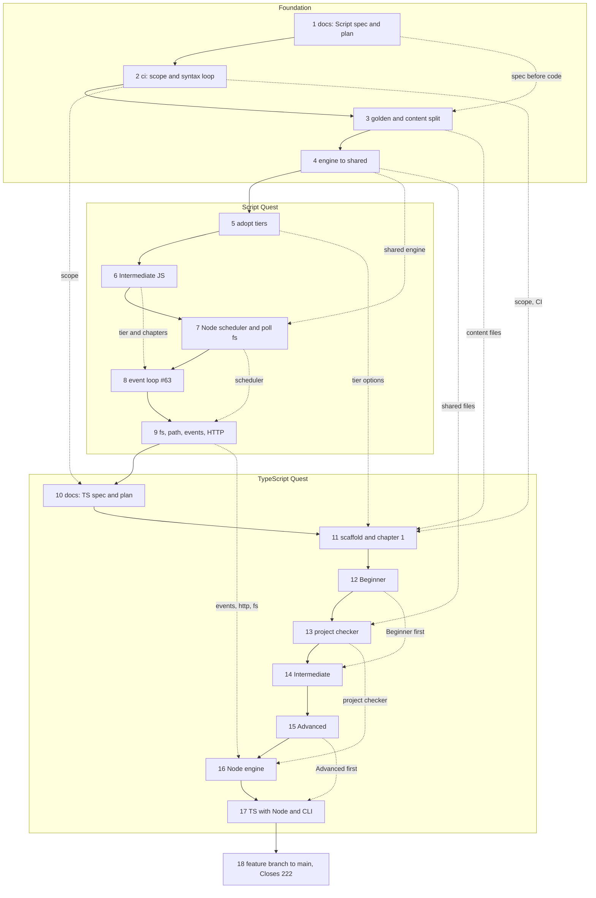

# Script Quest tiers, scheduler and engine: plan

Status: approved plan; PRs 10 to 18 are summary rows and are re-planned after PR 9.

**Contents:** [TLDR](#tldr) · [Goal](#goal) · [Global constraints](#global-constraints) · [Review Focus](#review-focus) · [PR split](#pr-split) · [Stack diagram](#stack-diagram) · [Stacking rules](#stacking-rules) · [Smoke-hook rule](#smoke-hook-rule) · [Keeping up with main](#keeping-up-with-main) · [Two decisions that live in this plan](#two-decisions-that-live-in-this-plan) · [Tasks for PRs 1 to 9](#tasks-for-prs-1-to-9) ([Task 1](#task-1-spec-and-plan-pr-1), [Task 2](#task-2-accept-the-typescript-scope-and-check-the-new-folders-pr-2), [Task 3](#task-3-golden-fixtures-and-the-content-split-pr-3), [Task 4](#task-4-move-the-engine-to-shared-pr-4), [Task 5](#task-5-adopt-the-shared-tier-model-pr-5), [Task 6](#task-6-intermediate-javascript-tier-pr-6), [Task 7](#task-7-virtual-node-scheduler-pr-7), [Task 8](#task-8-event-loop-chapter-pr-8), [Task 9](#task-9-async-fs-path-events-and-http-server-chapters-pr-9)) · [PRs 10 to 18](#prs-10-to-18)

## TLDR

- **The point:** Script Quest gets tiers, an 11-chapter Intermediate path and a virtual Node scheduler, with no change to any learner's XP, rank or saves. Then TypeScript Quest is built on the same shared engine.
- **The order:** 18 stacked PRs on `feat/222-ts-quest`. Foundation: 1 spec and plan, 2 CI scope, 3 golden and content split, 4 engine to `shared/`. Script: 5 tiers, 6 Intermediate JavaScript, 7 scheduler, 8 event loop chapter, 9 `fs`, `path`, events and HTTP. TypeScript: 10 spec and plan, 11 to 17 the quest and its engine. 18 merges the feature branch to `main`.
- **What the reader does:** merge each PR in order (squash, after review), approve each sync of `main` before it is pushed, and read the [Review Focus](#review-focus) list before approving a content PR. PRs 10 to 18 are re-planned after PR 9.

## Goal

Add tiers, an Intermediate path (chapters 13 to 23) and a virtual Node scheduler to Script Quest, move the JS realm, Node environment and TypeScript checker into `shared/`, then build TypeScript Quest on top. Epic #222, delivered as 18 stacked PRs on `feat/222-ts-quest`: 11 PRs for the Done-when items (5, 6, 8, 9, 10, 11, 12, 14, 15, 17, 18) and 7 prep PRs (1, 2, 3, 4, 7, 13, 16). No learner's XP, rank, progress or saved files change. This plan details PRs 1 to 9. PRs 10 to 18 are summary rows, re-planned after PR 9.

The spec is [2026-11-16-script-quest-tiers-design.md](../specs/2026-11-16-script-quest-tiers-design.md). It holds the decisions (D1, D6, D7, D8, D10, D13), the XP model, the chapter outline and the scheduler. This plan holds the order, the rules and the steps. Where the two overlap, the spec decides.

## Global constraints

- No build step, no framework, no new dependency. The repo stays static (`AGENTS.md` hard rules).
- Saved keys and mission keys are never renamed. Script's save key stays `script-quest-v1` with `-` between chapter and mission. New missions are only appended.
- Fixtures are never regenerated or edited to make a test pass. A test is never weakened, skipped or deleted.
- Engine files in `shared/` have no DOM: no `window`, `document` or `localStorage`.
- One concern per PR. Structure changes (PRs 3 and 4) change no behavior, and the golden proves it.
- A saved field goes through the `pristine` rule (`AGENTS.md:79`). PR 5 adds no stored field.
- Learner text follows the `mission-voice` and `add-mission` skills: the whole line explained first, then each part, with `how` steps.
- Conventional Commits. Never bump the version or edit `CHANGELOG.md`. The scope `typescript` exists from PR 2.
- Plans and specs merge before the code (`AGENTS.md:96`). PR 1 is that merge for the Script half.
- Docs and PR bodies carry no session link and no tool attribution.

## Review Focus

1. **The golden proves nothing changed** in PRs 3, 4 and 5: the same transcript, the same rail markup, the same saved game.
2. **Old saves keep XP and rank.** The stored `xp` is trusted and never recomputed. The Shell and Agent tier tests prove the new options default to the old behavior.
3. **Teach before use.** Every new term has a `FIRST` entry and no mission uses a term before its chapter. Every mission has solvability and own-input checks.
4. **The smoke hook is unedited** and passes in CI. See [Smoke-hook rule](#smoke-hook-rule).
5. **Phone width** for every content PR (6, 8, 9, and every TypeScript content PR).
6. **Shared-file hot spots** (`programming/script-quest/app.js`, `shared/catalog.js`, `tests/smoke.mjs`) re-checked against `main` before each PR is marked ready, because `main` keeps moving while the stack waits.
7. **Honest estimates.** Mission counts, the Sorcerer XP threshold and sizes are estimates until the chapters exist.

## PR split

Sizes are changed lines: S under 150, M up to 500, L up to 1000, XL above. "Needs" lists the PRs that must have merged first.

| # | Title | Contents | Needs | Size |
|---|---|---|---|---|
| 1 | `docs(script): add the Script Quest tiers, scheduler and engine spec and plan` | This plan and the [spec](../specs/2026-11-16-script-quest-tiers-design.md): XP model, rank names, story edit, Trophy decision, chapter outlines, engine move and scheduler, covering PRs 3 to 9. | none | M |
| 2 | `ci: accept the typescript scope and check the new quest folders` | The `typescript` scope in `commitlint.config.mjs`. In the `ci.yml` syntax loop, `shopt -s nullglob` plus globs for `programming/script-quest/*.js`, `programming/script-quest/content/*.js`, `programming/typescript-quest/*.js`, `programming/typescript-quest/content/*.js` and `tests/typescript/*.mjs`. The same loop in `AGENTS.md` and `.claude/skills/pre-pr-check/SKILL.md` is updated so the three copies match. A throwaway probe commit with a syntax error proves the check still fails, then is removed. | none | S |
| 3 | `refactor(script): add golden fixtures and split app.js into content files` | First commit: the golden save and transcript from the unmodified build. Then curriculum, guide and quick-fire move to `programming/script-quest/content/`, and the three test slicers are updated. The smoke hook keeps working. | 1, 2 | L |
| 4 | `refactor(engine): move the JS realm, Node env and TS checker to shared modules` | `shared/jsrealm.js`, `nodeenv.js` and `tscheck.js`. Script loads them, the golden proves nothing changed, and the engine's tests stay under `tests/script/`. The terminal interpreter and project panel stay in `app.js`. | 3 | L |
| 5 | `feat(script): adopt the shared tier model` | `Tiers.create` and `renderRail` options (`badgeXp` per tier, `doneSep`, rail attributes), an adapter view, `beginner` tags on 12 chapters, the rank table through `rankFor`, the fixture test, README and `AGENTS.md`, and the one amendment to `docs/tiers-guideline.md:7`. Shell tier tests prove the defaults are unchanged. | 4 | M |
| 6 | `feat(script): Intermediate JavaScript tier` | Chapters 13 to 19, the tier filter for guide and quick-fire, a `FIRST` entry for every new term, catalog and landing-card counts, and the `story.js` edit. | 5 | XL |
| 7 | `feat(engine): virtual Node scheduler with nextTick, microtasks, timers and poll-phase fs` | Browser spike first. Then a DOM-free scheduler with timers, poll (I/O completions) and check phases, a virtual clock and a loop guard. `fs.readFile` (callback) and `fs.promises` completions move to the poll phase. Sync `fs` calls charge virtual time. `vm` tests include a differential test against real `node`. | 4 | L |
| 8 | `feat(script): event loop chapter` | Chapter 20 with `how` steps, and the Field guide picture with a microtask lane and the Node phases. Covers all three outcomes of #63. | 6, 7 | M |
| 9 | `feat(script): async fs, path, events and HTTP server chapters` | Engine: folder keys, `path`, the rest of async `fs` (`readdir`, `appendFile`, `unlink`, `stat`), `EventEmitter`, `process`, `http`, a `curl` command and a running-process model. Then chapters 21 to 23, ending the Script treasure arc. | 7, 8 | XL |
| 10 | `docs(typescript): add the TypeScript Quest spec and plan` | `docs/superpowers/specs/2026-11-16-typescript-quest-design.md` and `docs/superpowers/plans/2026-11-16-typescript-quest-phase1.md`: chapter list, story, mission outline per chapter, engine plan, tier XP and ranks. Re-plans PRs 11 to 18. | 2, 9 | M |
| 11 | `feat(typescript): scaffold TypeScript Quest with tiers and chapter 1` | Folder `programming/typescript-quest/`, key `typescript-quest-v1`, `story.js`, landing card, catalog entry, tiers, chapter 1, the `test:engine` glob in `package.json` added together with the first `tests/typescript/` test, the smoke-test list, README, `AGENTS.md`, `CONTRIBUTING.md` scopes, and a pointer on Script chapter 11's completion screen. | 2, 3, 5, 10 | L |
| 12 | `feat(typescript): Beginner chapters` | 4 chapters (2 to 5) in REPL mode. | 11 | L |
| 13 | `feat(engine): multi-file TypeScript projects with tsconfig and a larger lib` | Multi-file programs, `import`, a `tsconfig` that changes compiler flags, a grown `TS_LIB`. Starts by measuring the real `lib.d.ts`. | 4 | L |
| 14 | `feat(typescript): Intermediate chapters` | 5 chapters (6 to 10). Modules uses project mode. | 12, 13 | XL |
| 15 | `feat(typescript): Advanced chapters` | 4 chapters (11 to 14). Starts with a spike on `intrinsic` template types. | 14 | L |
| 16 | `feat(engine): TypeScript in the virtual terminal, node:test and typings for Node` | `.ts` files accepted, `tsc` that really checks, `node --test`, a mini typings set for `fs`, `path`, `http`, `events`, `node:test` and `assert`, and more `process`. The terminal interpreter moves to `shared/`, and `app.js` rebinds `runShell`. | 9, 13 | L |
| 17 | `feat(typescript): TypeScript with Node tier and final project` | 4 chapters (15 to 18), ending with the typed CLI. | 15, 16 | XL |
| 18 | `feat(typescript): add TypeScript Quest and deepen Script Quest` | `feat/222-ts-quest` to `main`. | all | S |

Count: 18. Done-when PRs: 5, 6, 8, 9, 10, 11, 12, 14, 15, 17, 18. Prep PRs: 1, 2, 3, 4, 7, 13, 16.

## Stack diagram

Solid arrows are the stack order. Dotted arrows are hard dependencies on a PR other than the one before it. PR 18 needs all PRs.

## Stacking rules

- Every PR targets `feat/222-ts-quest`. That branch is cut from `main` before any code and is the only long-lived branch.
- A part opens only after its parent merges, and branches from the updated `feat/222-ts-quest`. No rebases are needed.
- Merges are squash-only and wait for the user. No agent merges.
- Only PR 2 touches `.github/workflows`, so it is the only PR pushed over SSH.
- Every PR body says "Part of #222" and never a closing keyword. Only PR 18 says `Closes #222` and `Closes #63`, and it says `Refs #42` with no closing keyword for #42. PR 18 merges the feature branch to `main`.
- Script improvements reach `main` only with PR 18.

## Smoke-hook rule

`tests/smoke.mjs:4229-4232` rewrites the end of `programming/script-quest/app.js` with a regex on the closing `})();` and appends a hook that exposes `CH`, `S`, `setChapter`, `goMission`, `runShell`, `submit`, `cmd`, `mk`, `INITIAL_FILES`, `openFile`, `saveFile`, `ed` and `MODE` from inside the closure. The hook also assigns `RUN` (in `clearRun`), so `RUN` must stay declared. It keeps working only while those names stay declared in `app.js` and the file still ends with `})();`. So:

- PR 3 loads the content files before `app.js` and binds `CH` once at the top of `app.js` from the content namespace.
- `INITIAL_FILES` stays in `app.js` (`programming/script-quest/app.js:856`), and the UI names stay put.
- PR 4 moves only DOM-free engine code, and `app.js` rebinds any moved name it still uses.
- The smoke test is not edited. It passing unchanged in CI is an acceptance check for PRs 3 and 4. It needs the jsDelivr CDN, so only CI proves it.

## Keeping up with main

Squash-only merges mean a sync PR would drop `main`'s ancestry and show `main`'s changes again in PR 18. So the mechanism is a merge of `origin/main` into `feat/222-ts-quest`, pushed to the feature branch only, never to `main`.

1. A read-only check comes first. It lists what `main` changed under `shared/`, `programming/script-quest/`, `shared/catalog.js` and `tests/`.
2. The merge result and its test run are shown to the user.
3. The user approves before the push.
4. If `main` changed `.github/workflows`, the push goes over SSH.

A sync runs when the check finds overlap, is checked before PRs 5 and 11, and always runs once before PR 18. Syncs are not PRs and do not count toward the 18.

## Two decisions that live in this plan

The spec defines D1, D6, D7, D8, D10 and D13. These two are about the plan itself.

| Id | Decision | Alternatives and why they lost |
|---|---|---|
| D11 | **One early `ci:` PR** (PR 2) adds `shopt -s nullglob` and all the new globs. Unmatched globs then do not break the loop, and every new file is checked from its first PR. The probe proves a syntax error still fails. The cost: a mistyped glob in a later PR is skipped silently. | Two strict `ci:` PRs, one after PR 3 and one after PR 11: no silent skips, but one more merge, and PR 11's own files would go unchecked until the second PR. |
| D12 | **Two spec-and-plan PRs:** Script first (PR 1), TypeScript after the Script work (PR 10), updated by any PR that changes its plan (13 and 15). | One spec for both, first: Script work waits on TypeScript decisions. A Script spec only outside the repo: breaks `AGENTS.md:96`. |

## Tasks for PRs 1 to 9

Each task is one PR. Branch from the updated `feat/222-ts-quest` after the parent merges. Every task ends with `npm run check` exiting 0 and, where it applies, the repo's "Before committing" checks in `AGENTS.md`.

### Task 1: Spec and plan (PR 1)

**Files:**
- Create: `docs/superpowers/specs/2026-11-16-script-quest-tiers-design.md`, `docs/superpowers/plans/2026-11-16-script-quest-tiers.md`

- [ ] **Step 1:** Check the PR title with commitlint (`script` and `docs` are in `commitlint.config.mjs:5-8`).
- [ ] **Step 2:** Re-read every `path:line` the spec and plan cite against the tree, and fix any that moved.
- [ ] **Step 3:** `npm run check` exits 0, and `git diff --name-only origin/main...HEAD` lists only the two files.
- [ ] **Step 4:** Search both files for a session link, tool attribution, private labels and implementation code: none. Fenced blocks are limited to file trees and mermaid diagrams.
- [ ] **Step 5:** Open the PR against `feat/222-ts-quest`. The body says "Part of #222", gives the part count and says the TypeScript spec follows at PR 10. The browser boxes of the PR template do not apply.

### Task 2: Accept the `typescript` scope and check the new folders (PR 2)

**Files:**
- Modify: `commitlint.config.mjs` (scope list, `:5-8`), `.github/workflows/ci.yml` (the syntax loop), `AGENTS.md:17`, `.claude/skills/pre-pr-check/SKILL.md` (the same loop)

- [ ] **Step 1: Verify the failure first.** On the feature branch, a `docs(typescript): x` header fails commitlint with a `scope-enum` error.
- [ ] **Step 2:** Add `typescript` to the scope list, keeping the order of the rest. The copy of the list in `CONTRIBUTING.md:57` is updated in PR 11.
- [ ] **Step 3:** In the `ci.yml` loop, add `shopt -s nullglob` and the five globs named in the [PR split](#pr-split). Make the two local copies match, keeping their existing `|| break` behavior.
- [ ] **Step 4: Probe.** Push a throwaway commit with a syntax error in a file the new globs match. Confirm the loop fails, then remove the commit. Note in the PR body that the probe only proves syntax errors still fail, not that a mistyped glob is caught.
- [ ] **Step 5:** `npm run check` exits 0. Push this one PR over SSH because it touches `.github/workflows`. Body says "Part of #222".

### Task 3: Golden fixtures and the content split (PR 3)

**Files:**
- Create: golden save and transcript fixtures under `tests/fixtures/` (`AGENTS.md:42`), the golden test (its location and runner are chosen here, following the Shell golden); `programming/script-quest/content/` (curriculum, guide, quick-fire)
- Modify: `programming/script-quest/app.js`, `programming/script-quest/index.html`, `tests/script/teach.test.mjs:9-11`, `tests/trophy/chapters.mjs:26-27`, `tests/content-loader.mjs:20-22`

- [ ] **Step 1 (first commit): capture the golden** from the unmodified build: an exported complete save and a transcript of every one of the 93 missions, plus a test that replays them. This commit contains no refactor. Do not regenerate these fixtures later.
- [ ] **Step 2:** Move the curriculum, guide and quick-fire out of `app.js` into `content/` files. Load them before `app.js` in `index.html`, and bind `CH` once at the top of `app.js` from the content namespace.
- [ ] **Step 3:** Update the three slicers, which cut content out of `app.js` by marker text, to read the new files. Keep their assertions.
- [ ] **Step 4:** Apply the [smoke-hook rule](#smoke-hook-rule): the listed names stay declared in `app.js`, `INITIAL_FILES` stays, the file keeps its closing `})();`, and `tests/smoke.mjs` is not edited.
- [ ] **Step 5:** The golden passes after every move, not only at the end. `npm run test:engine` and `npm run check` exit 0. The smoke test passing unchanged is checked in CI.

### Task 4: Move the engine to `shared/` (PR 4)

**Files:**
- Create: `shared/jsrealm.js`, `shared/nodeenv.js`, `shared/tscheck.js`
- Modify: `programming/script-quest/app.js`, `programming/script-quest/index.html`, the Script tests that load engine code

- [ ] **Step 1:** Before moving anything, record Script's script bytes and time to first render for the performance check.
- [ ] **Step 2:** Move the realm, the virtual Node environment (`fs`, `path`, `process`) and the TypeScript checker out of `app.js`, one file at a time, with no DOM access in any of them. `app.js` rebinds any moved name it still uses.
- [ ] **Step 3:** Leave the terminal interpreter and the project panel in `app.js`. If the panel does not separate cleanly, record that in the PR body (the spec's risk 3).
- [ ] **Step 4:** Tests stay under `tests/script/`, which the `test:engine` glob already covers. The golden passes after every move.
- [ ] **Step 5:** Compare page load against Step 1: at most 10% slower. `npm run test:engine` and `npm run check` exit 0. The smoke test passing unchanged is checked in CI.

### Task 5: Adopt the shared tier model (PR 5)

**Files:**
- Modify: `shared/tiers.js` (including `:72`, the done-key build in `renderRail`), the Shell tier tests, `programming/script-quest/app.js`, `docs/tiers-guideline.md:7`, `README.md`, `AGENTS.md`
- Create: a Script tier test with the old-save fixture

- [ ] **Step 1: Test first.** Add Shell tier tests that pin the current output of `Tiers.create` and `renderRail` for Shell Quest and Agent Quest, so the new options are proven to default to the old behavior.
- [ ] **Step 2:** Add `badgeXp` per tier (default 25) and `doneSep` (default `.`) to `Tiers.create`, and `doneSep` plus options for `data-c`, the chapter number in place of the ★ when earned, and group sub-headers to `renderRail`. The Step 1 tests still pass.
- [ ] **Step 3:** In `app.js`, tag the 12 chapters `beginner` with `badgeXp` 0 and `doneSep` `-`. Build the view at render time: badges derived from `done`, `ch` from `S.chap`. Route ranks through `rankFor` with the ladder up to Wizard at 700 unchanged. Add no stored field, and leave `fresh()` and the `pristine` rule alone.
- [ ] **Step 4:** Add the Script test: the old save fixture gives the same XP, rank, progress and rail markup as before. The golden still passes, and the smoke test's rail click by `data-c` (`tests/smoke.mjs:1689`) is not edited.
- [ ] **Step 5:** Amend the rule at `docs/tiers-guideline.md:7` to allow a per-tier `badgeXp`, and update README and `AGENTS.md`. Check the sync with `main` first (see [Keeping up with main](#keeping-up-with-main)).

### Task 6: Intermediate JavaScript tier (PR 6)

**Files:**
- Create: chapter files for chapters 13 to 19 under `programming/script-quest/content/`
- Modify: `programming/script-quest/story.js`, `shared/catalog.js`, the landing card, the guide and quick-fire content and their renderers, `programming/script-quest/app.js`

- [ ] **Step 1:** Add the Intermediate tier (15 XP per mission) with the group labels from the spec and the Sorcerer rank as the tier's end rank. Record the final XP threshold in the PR body, replacing the spec's estimate.
- [ ] **Step 2:** For each of chapters 13 to 19 (see the spec's [outline](../specs/2026-11-16-script-quest-tiers-design.md#intermediate-outline)), write about 6 missions with `how` steps, in dependency order. Each mission has a reference answer that passes its check, and a wrong answer and a lazy answer that do not. It completes only with its own input: an unrelated input completes no mission.
- [ ] **Step 3:** Add a `FIRST` entry for every new term. Add a tier filter to the guide and quick-fire so Beginner learners are not shown Intermediate material first.
- [ ] **Step 4:** Update the catalog and landing-card counts. Edit `story.js` only: the lantern becomes a mid-way prize and a new final Script treasure is added. Its name and wording are set here with the `quest-story` skill and `docs/story-guideline.md`. Do not rewrite chapter 12's own story.
- [ ] **Step 5:** Solvability, teach-before-use and own-input tests pass. Check every chapter at phone width. Note the Trophy Room effects in the PR body (spec: [Trophy Room](../specs/2026-11-16-script-quest-tiers-design.md#trophy-room)). `npm run test:engine` and `npm run check` exit 0.

### Task 7: Virtual Node scheduler (PR 7)

**Files:**
- Create: the scheduler file in `shared/` (name chosen here) and its tests under `tests/script/`
- Modify: `shared/nodeenv.js` (the `fs.readFile` timer is at `programming/script-quest/app.js:318-319` on the base and lives in this file after PR 4), `programming/script-quest/index.html` (to load the scheduler)

- [ ] **Step 1: Browser spike first.** In a real browser, check that shadowed timers and `nextTick` with one macrotask per real hop give the order in the spec's [scheduler diagram](../specs/2026-11-16-script-quest-tiers-design.md#scheduler): script, `nextTick`, microtasks, timers, poll, check. If it fails, stop and bring a new design to the user. Do not build further.
- [ ] **Step 2: Tests first.** Write `vm` ordering tests for sync code, `nextTick`, promises, timers, `setImmediate`, and `setImmediate` versus `setTimeout(0)` inside an I/O callback. Add a differential test that runs the same programs under real `node` and compares output.
- [ ] **Step 3:** Build the DOM-free scheduler: shadowed timers and `nextTick`, a virtual loop, a virtual `Date.now` that ends busy-waits, and an acorn-inserted iteration count as the loop guard.
- [ ] **Step 4:** Move `fs.readFile` (callback) and `fs.promises` completions into the poll phase, replacing the real 5 ms timer. Charge virtual time to sync `fs` calls (for example by file size), so a heartbeat timer visibly stalls.
- [ ] **Step 5:** The golden transcript still passes for the existing Node.js chapter. The longest ordering test finishes well under a second. Measure and report the loop guard's overhead and the sync-read charge. `npm run test:engine` and `npm run check` exit 0.

### Task 8: Event loop chapter (PR 8)

**Files:**
- Create: the chapter 20 content file
- Modify: `programming/script-quest/content/` (guide), `shared/catalog.js`, the landing card, `programming/script-quest/app.js` (the Field guide picture)

- [ ] **Step 1:** Write chapter 20, with `how` steps and about 6 missions covering all three outcomes of #63: predict-the-order puzzle missions, `setImmediate` versus `setTimeout(0)` inside an I/O callback only, and a heartbeat `setInterval` that stalls on a sync read but not on async `fs.readFile`.
- [ ] **Step 2:** No mission depends on the main-module `setImmediate` versus `setTimeout(0)` order, which is not deterministic in real Node. A busy-wait on the virtual `Date.now` stalls the heartbeat too.
- [ ] **Step 3:** Add the Field guide picture with a microtask lane plus the three Node phases. Add `FIRST` entries for the new terms.
- [ ] **Step 4:** Update catalog and landing-card counts. Solvability, teach-before-use and own-input tests pass, and the chapter is checked at phone width.
- [ ] **Step 5:** `npm run test:engine` and `npm run check` exit 0. The chapter needs only PRs 6, 7 and 8, so the PR body says it meets the Done-when of #63 without PR 9.

### Task 9: Async `fs`, `path`, events and HTTP server chapters (PR 9)

**Files:**
- Modify: `shared/nodeenv.js`, the terminal interpreter and project panel in `programming/script-quest/app.js`, `programming/script-quest/story.js`, `shared/catalog.js`, the landing card
- Create: chapter files for chapters 21 to 23 and their tests

- [ ] **Step 1: Tests first** for each engine feature below, under `tests/script/`, with a differential check against real `node` where output order matters.
- [ ] **Step 2:** Engine, part one: `/` folder keys in the existing flat file map (additive), `path`, and the rest of async `fs` (`readdir`, `appendFile`, `unlink`, `stat`) in the poll phase.
- [ ] **Step 3:** Engine, part two: `EventEmitter`, `process`, `http` with a server table, a `curl` terminal command over that table, and a running-process model with a Stop button for `node server.js`.
- [ ] **Step 4:** Write chapters 21 to 23 (async `fs` and `path`, Events, A small HTTP server) with `how` steps. Chapter 23 repeats the heartbeat stall on a virtual server with `curl`. The final Script treasure arc ends here, in `story.js`, with the circus ready to tour.
- [ ] **Step 5:** Update catalog and landing-card counts, and check phone width including the Stop button. `npm run test:engine` and `npm run check` exit 0. The smoke test passes unchanged in CI.

## PRs 10 to 18

Summary rows only; the [PR split](#pr-split) table above holds title, contents, needs and size. PR 10 is the TypeScript spec and plan. It is written after PR 9 so it uses the real scheduler and typings, and it re-plans PRs 11 to 18 into tasks. PR 13 revises it if the `lib.d.ts` measurement changes the plan, and PR 15 does the same if the `intrinsic` spike fails. PR 11 needs a sync check with `main` first. PR 18 needs a sync with `main` first, merges the feature branch to `main`, and carries `Closes #222`, `Closes #63` and `Refs #42` (see [Stacking rules](#stacking-rules)).
