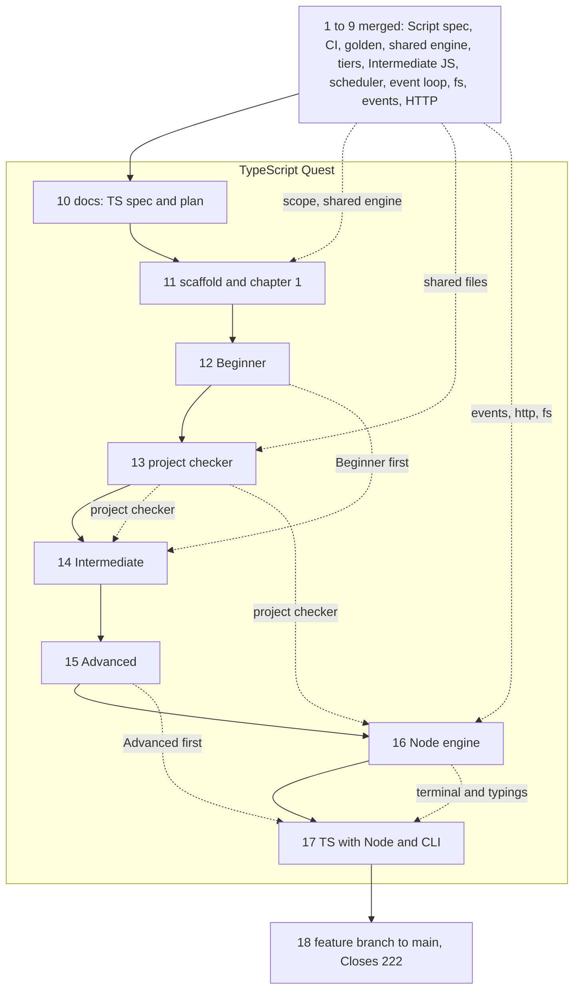

# TypeScript Quest: plan for PRs 10 to 18

Status: approved design, with the TypeScript Quest world, chapters and tier XP approved as proposed. This is the re-plan that the [Script plan](2026-11-16-script-quest-tiers.md) promised for its "PRs 10 to 18" summary rows; where the two differ for those PRs, this plan decides. The Script plan and spec are not edited.

**Contents:** [TLDR](#tldr) · [Goal](#goal) · [Global constraints](#global-constraints) · [Review Focus](#review-focus) · [PR split](#pr-split) · [Stack diagram](#stack-diagram) · [Stacking rules](#stacking-rules) · [Keeping up with main](#keeping-up-with-main) · [Tasks for PRs 11 to 17](#tasks-for-prs-11-to-17) ([Task 11](#task-11-scaffold-typescript-quest-and-chapter-1-pr-11), [Task 12](#task-12-beginner-chapters-pr-12), [Task 13](#task-13-multi-file-projects-tsconfig-and-a-larger-lib-pr-13), [Task 14](#task-14-intermediate-chapters-pr-14), [Task 15](#task-15-advanced-chapters-pr-15), [Task 16](#task-16-typescript-in-the-virtual-terminal-nodetest-and-typings-for-node-pr-16), [Task 17](#task-17-typescript-with-node-tier-and-final-project-pr-17)) · [PR 18](#pr-18) · [Follow-up issues](#follow-up-issues) · [Deferred decisions](#deferred-decisions)

## TLDR

- **The point:** build TypeScript Quest (18 chapters in four tiers, treasure: the Golden Timetable) on the shared engine that PRs 4, 7 and 9 shipped, then merge the feature branch to `main`.
- **The order:** 10 the spec and this plan, 11 the scaffold and chapter 1, 12 Beginner chapters, 13 multi-file projects and a larger lib, 14 Intermediate chapters, 15 Advanced chapters, 16 TypeScript in the virtual terminal, 17 the TypeScript with Node tier, 18 the merge to `main`.
- **What the reader does:** merge each PR in order (squash, after review), approve each sync of `main` before it is pushed, and read the [Review Focus](#review-focus) list before approving a content PR. Three proposals in the [spec](../specs/2026-11-16-typescript-quest-design.md) wait for sign-off, and one decision (how the tests run the TypeScript compiler in Node) must be settled before PR 11.

## Goal

Deliver the rest of epic #222 (TypeScript Quest, and deeper JavaScript and Node in Script Quest): the TypeScript Quest spec and this plan (PR 10), then the quest itself in `programming/typescript-quest/` with the save key `typescript-quest-v1` and tests in `tests/typescript/` (PRs 11 to 17), then the merge of `feat/222-ts-quest` to `main` (PR 18). The chapters, story, tier XP, ranks and engine needs are in the [spec](../specs/2026-11-16-typescript-quest-design.md). This plan holds the order, the rules and the steps.

## Global constraints

- No build step, no framework, no new dependency without a user decision. The repo stays static (`AGENTS.md` hard rules). The compiler-in-Node-tests decision (see [Deferred decisions](#deferred-decisions)) is the one place a dependency is proposed.
- The save key `typescript-quest-v1` is never renamed. Done-keys are `<chapter>.<mission>`. New missions are only appended.
- Fixtures are never regenerated or edited to make a test pass. A test is never weakened, skipped or deleted.
- Engine files in `shared/` have no DOM: no `window`, `document` or `localStorage`.
- One concern per PR. Engine PRs (13 and 16) change no chapter text, and content PRs change no engine code except what a chapter's own tests need.
- A saved field goes through the `pristine` rule (`AGENTS.md:80`). Badges are derived from `done` (D14, proposed), so no stored field is added.
- Learner text follows the `mission-voice` and `add-mission` skills: the whole line explained first, then each part, with `how` steps. Story text follows `docs/story-guideline.md` and the `quest-story` skill.
- Teach before use: every new term has a `FIRST` entry and no mission uses a term before its chapter. `Promise<T>` is first taught in chapter 6.
- Conventional Commits with the scopes `typescript`, `engine` and `docs`. Never bump the version or edit `CHANGELOG.md`.
- Docs and PR bodies carry no session link and no tool attribution.

## Review Focus

1. **Every mission is solvable and own-input.** The solvability test passes for every mission answer, a wrong answer and a lazy answer do not pass, and an unrelated input completes no mission.
2. **Teach before use.** Every new term has a `FIRST` entry in the same shape as `tests/script/teach.test.mjs`, and the order matches the spec's chapter terms.
3. **Diagnostic codes are measured.** The codes in the spec's outlines are expected values; each is confirmed against the compiler when its chapter is written.
4. **The smoke hook is unedited** where it applies, and passes in CI. See the Script plan's [Smoke-hook rule](2026-11-16-script-quest-tiers.md#smoke-hook-rule).
5. **Phone width** for every content PR (12, 14, 15, 17) and for PR 11's first chapter, including the compiler-failed state and the running-process indicator.
6. **Shared-file hot spots** (`shared/catalog.js`, `tests/smoke.mjs`, `programming/script-quest/app.js`) re-checked against `main` before each PR is marked ready, because `main` keeps moving while the stack waits.
7. **Honest estimates.** Mission counts, XP totals, thresholds and sizes are estimates until the chapters exist.
8. **Engine PRs measure, not assume.** PR 13 reports the real `lib.d.ts` measurement, and PRs 15 and 16 verify the `intrinsic` and Node type-stripping questions the spec leaves open.

## PR split

Sizes are changed lines: S under 150, M up to 500, L up to 1000, XL above. "Needs" lists the PRs that must have merged first.

| # | Title | Contents | Needs | Size |
|---|---|---|---|---|
| 10 | `docs(typescript): add the TypeScript Quest spec and plan` | The [spec](../specs/2026-11-16-typescript-quest-design.md) and this plan: chapter list, story, mission outline per chapter, engine plan, tier XP and ranks. Re-plans PRs 11 to 18. | 2, 9 | L |
| 11 | `feat(typescript): scaffold TypeScript Quest with tiers and chapter 1` | Folder `programming/typescript-quest/`, key `typescript-quest-v1`, `story.js`, landing card, catalog entry, tiers, chapter 1, the `test:engine` glob in `package.json` added together with the first `tests/typescript/` test, the smoke-test list, README, `AGENTS.md`, `CONTRIBUTING.md` scopes, and a pointer on Script chapter 11's completion screen. | 2, 3, 5, 10 | L |
| 12 | `feat(typescript): Beginner chapters` | Chapters 2 to 5 in REPL mode. | 11 | L |
| 13 | `feat(engine): multi-file TypeScript projects with tsconfig and a larger lib` | A project checker, `import` between files, a `tsconfig` that changes compiler flags, a grown `TS_LIB`. Starts by measuring the real `lib.d.ts`. | 4 | L |
| 14 | `feat(typescript): Intermediate chapters` | Chapters 6 to 10. Chapter 10 (Modules) uses project mode. | 12, 13 | XL |
| 15 | `feat(typescript): Advanced chapters` | Chapters 11 to 14. Starts with a spike on `intrinsic` template types. | 14 | L |
| 16 | `feat(engine): TypeScript in the virtual terminal, node:test and typings for Node` | `.ts` files accepted, a `tsc` that really checks, `node --test`, mini typings for `fs`, `path`, `http`, `events`, `node:test` and `assert`, and more of `process`. The terminal interpreter moves to `shared/`, and `app.js` rebinds `runShell`. | 9, 13 | L |
| 17 | `feat(typescript): TypeScript with Node tier and final project` | Chapters 15 to 18, ending with the typed CLI. | 15, 16 | XL |
| 18 | `feat(typescript): add TypeScript Quest and deepen Script Quest` | `feat/222-ts-quest` to `main`. | all | S |

Count: 9 rows here (PRs 10 to 18), the second half of the 18-PR stack. PR 12 has the Beginner chapters 2 to 5 only, because chapter 1 ships in PR 11.

## Stack diagram

Solid arrows are the stack order. Dotted arrows are hard dependencies on a PR other than the one before it. PR 18 needs all PRs. PRs 1 to 9 are merged and shown as one node.

## Stacking rules

- Every PR targets `feat/222-ts-quest`. That branch is the only long-lived branch.
- A part opens only after its parent merges, and branches from the updated `feat/222-ts-quest`. No rebases are needed.
- Merges are squash-only and wait for the user. No agent merges.
- No PR from 10 to 17 touches `.github/workflows`, so none needs the SSH push that PR 2 used.
- Every PR body says "Part of #222" and never a closing keyword. Only PR 18 says `Closes #222` and `Closes #63`, and it says `Refs #42` with no closing keyword for #42.
- Script improvements reach `main` only with PR 18.
- A PR that changes this plan's assumptions updates the [spec](../specs/2026-11-16-typescript-quest-design.md) in the same PR (PR 13 for the lib measurement, PR 15 for the `intrinsic` spike, PR 16 for the Node typing facts).

## Keeping up with main

The mechanism is the one in the Script plan's [Keeping up with main](2026-11-16-script-quest-tiers.md#keeping-up-with-main): a merge of `origin/main` into `feat/222-ts-quest`, pushed to the feature branch only, after a read-only check and the user's approval. It is not a PR and does not count toward the 18.

- **Before PR 11:** check what `main` changed under `shared/`, `shared/catalog.js`, `programming/script-quest/` and `tests/`. PR 11 edits the catalog, the smoke-test list and `app.js`'s completion screen, so overlap is likely.
- **Before PR 18:** always run a sync. PR 18 merges the whole branch, so the sync result and its test run are shown to the user before the push.

## Tasks for PRs 11 to 17

Each task is one PR. Branch from the updated `feat/222-ts-quest` after the parent merges. Every task ends with `npm run test:engine` and `npm run check` exiting 0, and the repo's "Before committing" checks in `AGENTS.md`. Content PRs also check every chapter at phone width (390 px).

### Task 11: Scaffold TypeScript Quest and chapter 1 (PR 11)

**Files:**
- Create: `programming/typescript-quest/` (`index.html`, `app.js`, `style.css`, `story.js`, `tiers.js`, `content/` with chapter 1, `quickfire.js` and `guide.js`), `tests/typescript/` (the first test)
- Modify: `shared/catalog.js`, the landing card in `programming/index.html`, `tests/trophy/chapters.mjs`, `NAMES` in `tests/smoke.mjs`, `package.json` (the `test:engine` glob), `README.md`, `AGENTS.md` (a new row in "Where things go" and an entry in the quest list under "What this is", as the `new-playground` skill asks), `CONTRIBUTING.md` (scopes), `programming/script-quest/` (a pointer on chapter 11's completion screen), `tests/tools/progress-pristine.test.mjs`, `.claude/skills/pre-pr-check/SKILL.md` if a syntax-loop glob is needed

The file list follows the `new-playground` skill (`.claude/skills/new-playground/SKILL.md`) and the "Add a whole playground" row in `AGENTS.md:79`. The quick-fire and Field guide are part of the course the skill lists: PR 11 creates `content/quickfire.js` and `content/guide.js` with the tier filter and chapter 1's entries, and each content PR (12, 14, 15, 17) adds its chapters' quick-fire questions and guide entries. The `typescript` scope is already accepted, and the CI syntax loop already lists the new folders (PR 2), so no workflow changes.

- [ ] **Step 1: Settle the open decisions in the PR's description.** Record the compiler-in-Node-tests decision (the user's answer), whether the REPL block and the value formatter in `programming/script-quest/app.js` move to `shared/` or are copied (#229), and whether the TypeScript console gets the loop guard (#241). Do not start code until the compiler decision is answered.
- [ ] **Step 2: Test first.** Add the first `tests/typescript/` test (a tier test pinning chapter counts and derived ranks, like `tests/script/tiers.test.mjs`) and the `tests/typescript/*.test.mjs` glob in `test:engine` together, so the glob never matches nothing. Add the quest's case to `tests/tools/progress-pristine.test.mjs`.
- [ ] **Step 3:** Scaffold the folder from the shape of Script Quest: `window.PROGRESS` with key `typescript-quest-v1`, the shared scripts in the order the skill lists, `story.js` from the spec's [Story](../specs/2026-11-16-typescript-quest-design.md#story) section, `tiers.js` with the proposed ranks and `Tiers.create` options (mission XP 10, 15, 20, 25; `badgeXp` default), badges derived from `done` (D14).
- [ ] **Step 4:** Write chapter 1 (about 7 missions, with `how` steps) from the spec's outline, a `FIRST` entry for every term, its quick-fire and Field guide entries, the catalog entry (`sep: '.'`), the landing card, the Script chapter 11 pointer, and the README, `AGENTS.md` and `CONTRIBUTING.md` edits. Record the Trophy Room effect in the PR body (everyone loses "Wanderer" until they start TypeScript Quest; "Playground Master: Programming" and "Grand Master" need it finished).
- [ ] **Step 5:** Solvability, teach-before-use and own-input tests pass. Check chapter 1 at phone width, including the compiler-failed message and retry. `npm run test:engine` and `npm run check` exit 0. Run the sync check with `main` first (see [Keeping up with main](#keeping-up-with-main)).

### Task 12: Beginner chapters (PR 12)

**Files:**
- Create: chapter files for chapters 2 to 5 under `programming/typescript-quest/content/`
- Modify: `programming/typescript-quest/app.js` if a chapter needs it, `content/quickfire.js` and `content/guide.js` (entries for chapters 2 to 5), `shared/catalog.js` (mission counts), the landing card, the `FIRST` table and tests in `tests/typescript/`

- [ ] **Step 1:** Write chapters 2 to 5 (Unions and narrowing, Aliases and interfaces, Typed functions, Arrays and tuples) from the spec's outlines, about 6 missions each, with `how` steps, in dependency order.
- [ ] **Step 2:** Each mission has a reference answer that passes its check, and a wrong answer and a lazy answer that do not. It completes only with its own input.
- [ ] **Step 3:** Confirm each expected diagnostic code against the compiler. Add a `FIRST` entry for every new term, the quick-fire and Field guide entries for chapters 2 to 5, and the soft "Suggested first" line under each title as the spec's [Suggested first](../specs/2026-11-16-typescript-quest-design.md#suggested-first) table gives it.
- [ ] **Step 4:** Update the catalog and landing-card counts. Note in the PR body any `TS_LIB` gap a mission hit, so PR 13 covers it.
- [ ] **Step 5:** Solvability, teach-before-use and own-input tests pass. Check every chapter at phone width. `npm run test:engine` and `npm run check` exit 0.

### Task 13: Multi-file projects, `tsconfig` and a larger lib (PR 13)

**Files:**
- Modify: `shared/tscheck.js`, `programming/typescript-quest/app.js` (the project panel), the spec if the measurement changes the plan
- Create: project-checker tests under `tests/typescript/`

- [ ] **Step 1: Measure first.** Compare the real `lib.d.ts` against the grown hand lib: bytes, first-load time and per-run check time on a throttled phone profile, for the REPL today, multi-file with the grown lib, and the real-lib option. Report the numbers in the PR body and update the spec if they change the plan.
- [ ] **Step 2: Tests first.** Write `vm` tests for the project checker: several files, `import` between them, a missing import (TS2307), a wrong name (TS2305), and a `tsconfig` that turns a strict flag on and off.
- [ ] **Step 3:** Add the project checker to `TSCheck` (the existing `check` stays unchanged), reading the `tsconfig` through `ts.parseJsonConfigFileContent`. Measure the `createProgram` re-parse per run. Decide in the PR's description whether the project panel separates from Script's `app.js` or TypeScript Quest carries a thin copy.
- [ ] **Step 4:** Grow `TS_LIB` with what the spec's [Engine plan](../specs/2026-11-16-typescript-quest-design.md#engine-plan) lists for chapters 1 to 14: `Extract`, `NonNullable`, `Parameters`, `InstanceType`, and `Object.keys`, `Map`, `Set` or `Date` if a mission uses them. Keep `Uppercase` and the like for PR 15's spike.
- [ ] **Step 5:** The existing Script TypeScript chapter still passes. `npm run test:engine` and `npm run check` exit 0. Check the page-load limit (no more than 10% slower than the Script baseline).

### Task 14: Intermediate chapters (PR 14)

**Files:**
- Create: chapter files for chapters 6 to 10 under `programming/typescript-quest/content/`
- Modify: `programming/typescript-quest/app.js` (project mode for chapter 10), `content/quickfire.js` and `content/guide.js`, `shared/catalog.js`, the landing card, the `FIRST` table and tests in `tests/typescript/`

- [ ] **Step 1:** Write chapters 6 to 9 (Generics, Classes and access modifiers, Literal types and enums, Utility types) in REPL mode. Chapter 6 teaches `Promise<T>` for the first time, so chapters 16 and 17 can use it.
- [ ] **Step 2:** Write chapter 10 (Modules) in project mode, with several `.ts` files run through the virtual Node's CommonJS. Its checks read the code that ran, not the live files (#245 is for awareness; see [Follow-up issues](#follow-up-issues)).
- [ ] **Step 3:** Each mission has a reference answer, a wrong answer and a lazy answer, and completes only with its own input. Confirm each diagnostic code against the compiler. Add a `FIRST` entry for every term, and the quick-fire and Field guide entries for chapters 6 to 10.
- [ ] **Step 4:** Update the catalog and landing-card counts. Chapter 8 does not repeat chapter 2's literal unions.
- [ ] **Step 5:** Solvability, teach-before-use and own-input tests pass. Check every chapter at phone width. `npm run test:engine` and `npm run check` exit 0.

### Task 15: Advanced chapters (PR 15)

**Files:**
- Create: chapter files for chapters 11 to 14 under `programming/typescript-quest/content/`
- Modify: `shared/tscheck.js` (the case-changing types), the spec if the spike fails, `content/quickfire.js` and `content/guide.js`, `shared/catalog.js`, the landing card, the `FIRST` table and tests in `tests/typescript/`

- [ ] **Step 1: Spike first.** Check whether `intrinsic` works in the hand lib (it is plausible only because `lib.d.ts` is passed as the default lib name). If it fails, update the spec and bring a new approach for chapter 14 to the user before building it.
- [ ] **Step 2:** Write chapters 11 to 13 (`keyof` and indexed access, Mapped types, Conditional types) with `how` steps. Chapter 13 is where `Awaited` is taught.
- [ ] **Step 3:** Write chapter 14 (Template literal types) with its "Suggested first" link as Named boxes (2), once the user has signed off the correction.
- [ ] **Step 4:** Add a `FIRST` entry for every term, the quick-fire and Field guide entries for chapters 11 to 14, and update the catalog and landing-card counts.
- [ ] **Step 5:** Solvability, teach-before-use and own-input tests pass. Check every chapter at phone width. `npm run test:engine` and `npm run check` exit 0.

### Task 16: TypeScript in the virtual terminal, `node:test` and typings for Node (PR 16)

**Files:**
- Modify: `shared/nodeenv.js`, `shared/scheduler.js` if `node --test` needs it, the terminal interpreter (moves to `shared/`), `programming/script-quest/app.js` and `programming/typescript-quest/app.js` (rebind `runShell`)
- Create: the shared terminal file, mini typings for Node, and their tests under `tests/typescript/`

- [ ] **Step 1: Tests first.** Write `vm` tests for `tsc` that really checks, `node file.ts` by transpiling, `node --test` output, `process.stderr` and `stdin` if the typed CLI needs them, and a differential check against real `node` where output order matters. Keep Script's golden transcript passing.
- [ ] **Step 2:** Decide in the PR's description, and record in the spec: how the terminal runs `.ts` (a `tsc` that checks, plus `node file.ts` by transpiling, since erasable-only type stripping would not run the enums and parameter properties chapters 7 and 8 teach), whether `NODE_VERSION` (`v22.12.0`, `shared/nodeenv.js:8`) is bumped, the test-runner output format, and the `node:test` and `assert` runtime. Verify any Node type-stripping fact before stating it.
- [ ] **Step 3:** Move the terminal interpreter to `shared/`, and have `app.js` rebind `runShell`. Add `.ts` handling, `tsc`, `node --test`, and the `node:test` and `assert` runtime.
- [ ] **Step 4:** Add mini typings for `fs` (including promises), `path`, `http`, `events`, `node:test`, `assert` and `process`. Chapter 16's `http.get` needs #246 (see [Follow-up issues](#follow-up-issues)).
- [ ] **Step 5:** A scheduler-driven `node --test` run finishes well under a second. Script Quest's golden still passes. `npm run test:engine` and `npm run check` exit 0. The smoke test passing unchanged is checked in CI.

### Task 17: TypeScript with Node tier and final project (PR 17)

**Files:**
- Create: chapter files for chapters 15 to 18 under `programming/typescript-quest/content/`
- Modify: `programming/typescript-quest/story.js` (the Golden Timetable ending), `programming/typescript-quest/app.js` (the running-process indicator), `content/quickfire.js` and `content/guide.js`, `shared/catalog.js`, the landing card, the `FIRST` table and tests in `tests/typescript/`

- [ ] **Step 1:** Write chapters 15 to 17 (`tsconfig` and strict mode, Typing `fs` and `http`, `node:test`) with `how` steps, using project mode and the terminal from PR 16.
- [ ] **Step 2:** Write chapter 18 (the typed CLI, about 8 missions) ending with the Golden Timetable. Missions that need `cd` or `rm -r` in the terminal depend on #247 (see [Follow-up issues](#follow-up-issues)); the PR's description says whether PR 16 or this PR carries it. The exit-code mission (mission 6) reads the code with `echo $?` in the terminal in the spec's outline; that is unverified until PR 16, and the check may read `process.exitCode` from the run instead.
- [ ] **Step 3:** Each mission has a reference answer, a wrong answer and a lazy answer, and completes only with its own input. Chapter checks read the code that ran. Add a `FIRST` entry for every term, and the quick-fire and Field guide entries for chapters 15 to 18.
- [ ] **Step 4:** Fix the tier-end thresholds and XP totals from the real mission counts, and record them in the PR body in place of the spec's estimates. Update the catalog and landing-card counts and the story ending.
- [ ] **Step 5:** Solvability, teach-before-use and own-input tests pass. Check every chapter at phone width, including the running-process indicator. `npm run test:engine` and `npm run check` exit 0.

## PR 18

`feat(typescript): add TypeScript Quest and deepen Script Quest` merges `feat/222-ts-quest` to `main`. It needs every earlier PR.

- Run the sync with `main` first (see [Keeping up with main](#keeping-up-with-main)), and show the result and its test run to the user before the push.
- The body says `Closes #222` and `Closes #63`, and `Refs #42` with no closing keyword for #42. #222 is the epic, #63 is the event loop chapter, and #42 is the issue the epic only references.
- Run the full checks (`npm run test:engine`, `npm run check`, and the browser tests in CI) and summarise what reaches `main`: Script Quest's tiers, Intermediate JavaScript and Node chapters, and TypeScript Quest.

## Follow-up issues

Open issues that name a later part. #229 is owned by a PR; the rest are for awareness, each with whether a later PR touches it.

| Issue | What it is | Later PR |
|---|---|---|
| #229 | Decide move or copy of Script Quest's value formatter for TypeScript Quest (the REPL block it sits in is bigger than the formatter) | PR 11's description decides and records it |
| #230 | Remove dead `off` and `shift` variables in `prepare`'s eval branch (`shared/jsrealm.js:75`) | Awareness: PR 11's REPL calls `prepare`, but no later PR needs the fix |
| #241 | Script Quest: stop runaway loops in the JS console (`execJS` has no loop guard) | PR 11's description decides whether the TypeScript console folds the fix in, since 13 of its chapters use the REPL |
| #245 | Script Quest: older mission checks read live files instead of the code that ran | Awareness: PRs 14 and 17 write project-mode checks and read the code that ran |
| #246 | Script Quest: `http.get`, `http.request`, request bodies and streams in the virtual Node | PR 16 if chapter 16's typed handler missions need `http.get` |
| #247 | Script Quest terminal: `rm` and `rmdir` for folders, and `cd` | PR 16 or PR 17 if chapter 18's files-in-folders missions need them |

## Deferred decisions

Decisions that wait for the owner PR's own description. Each has an owner PR.

| Decision | Owner |
|---|---|
| How the tests run the TypeScript compiler in Node: add `typescript` pinned to 5.9.3 as a dev dependency, or check only in the browser smoke test. The user decides; it does not block PR 10 | The user, before PR 11 |
| Value formatter and REPL block: move to `shared/` or copy (#229). The same PR decides the loop guard for the TypeScript console (#241) | PR 11 |
| Whether the project panel UI separates from Script's `app.js` or TypeScript Quest carries a thin copy | PR 11 and PR 13 |
| Lib measurement and `TS_LIB` growth. The grown lib's per-chapter needs come from the spec's engine table | PR 13 |
| Project checker API: multi-file `check`, `tsconfig` through `ts.parseJsonConfigFileContent`, re-parse cost | PR 13 |
| `intrinsic` in a hand lib. Unverified until the spike | PR 15 |
| How the virtual terminal runs `.ts`, and whether `NODE_VERSION` is bumped (the repo requires Node 24). Real Node's default type-stripping version is not verified here | PR 16 |
| Test-runner output format, the `node:test` and `assert` runtime and typings, `process.stderr` and `stdin` for the typed CLI | PR 16 |
| Rail group labels per tier, if any (`showHeader` stays true) | PR 11 |
| Sign-off on the proposals in the spec: rank names and base thresholds, D14 (badges derived from `done`), and the "Suggested first" corrections for chapters 6 and 14 | The user, before PR 11 |
