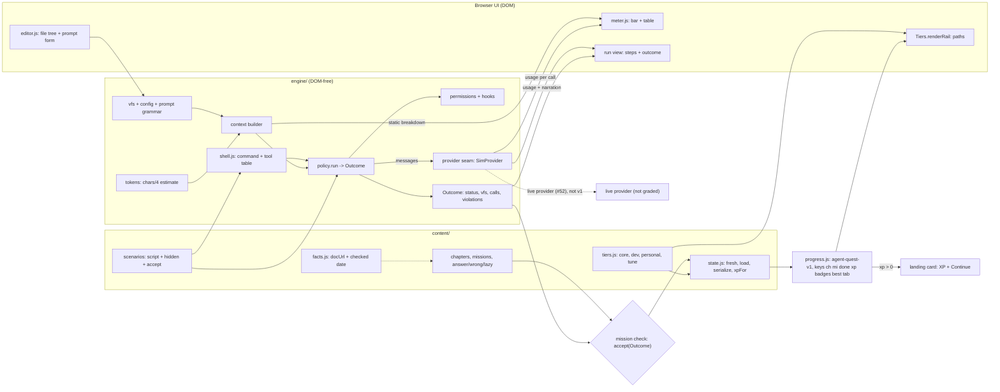

# Agent Quest (`agent-quest/`) design

Date: 2026-11-01. Status: approved design, nothing built yet. Issue: #51. Live mode is #52 and is not part of this spec.

## Goal

A new playground that teaches how to work well with AI coding agents: how the agent loop and the context window work, how to write a prompt, where memory, skills, MCP, hooks and subagents fit, how to keep an agent safe, and how to trim a setup that has grown too heavy. Same quest format as the others: chapters of missions with honest checks, quick-fire, field guide, XP and ranks.

Learners work against a **simulated agent**. They edit a small virtual project (files, `CLAUDE.md`, skills, MCP list, permission rules, hooks, subagents) and fill in a **structured prompt form**. A deterministic policy then "runs the agent" and produces an outcome the check can grade. Nothing calls a real model or the network.

Three paths share one engine: **core** (everyone), **dev** (working in a repo), **personal** (calendar, mail, notes, schedules). A fourth, **tune**, is about measuring and trimming a setup.

## Decisions

- **One playground, 23 chapters, four paths.** Core 7, dev 8, personal 5, tune 3. Paths are `Tiers`, not separate quests.
- **v1 is simulated only.** The Outcome comes from a deterministic policy, never from a model. A live provider (R5-live, R7, R9) is #52.
- **Closed prompt grammar over structured fields**, not free-text parsing. See "Simulator model".
- **Strict linear PR chain, 0 to 7.** Chapter order is merge order, so shipped mission keys never move.
- **Own small engine**, as Net Quest did. It stays DOM-free and loads as plain scripts in one global namespace.
- **No learner text is persisted.** Nothing a learner types reaches `localStorage`, the export or the linked backup file.
- **Dated content is visible, not enforced.** A registry of volatile facts with check dates and a render-time banner. No test fails on age.
- **Teaching-scale window and simplified config formats**, labelled as simulated, with links to the real docs.

## Scope

In scope: the engine, the UI, 23 chapters, quick-fire, field guide, ranks, tests and repo wiring, delivered as PRs 2 to 7.

Out of scope here:

- Live mode and any network call (#52). The CORS list and provider quirks belong there; this spec does not carry them.
- Real prices, real model names and real token counts. The meter is an estimate.
- Parsing real `CLAUDE.md`, skill, hook or MCP file formats exactly. The simulator uses simplified formats.

PR 1 (this spec and the plan) changes docs only. No `agent-quest/` code, landing, README, `smoke.mjs`, `package.json`, `ci.yml`, `pre-pr-check` or `AGENTS.md` edit lands in it.

## Delivery: the 8-PR chain

The chain is strict and linear: 0, 1, 2, 3, 4, 5, 6, 7. Each PR starts only after the one before it has merged.

| # | Ref | Title | Content | Depends on |
|---|---|---|---|---|
| 0 | #61 | `ci: allow the agent commit scope` | `agent` (and the missing `net`) in `commitlint.config.mjs`, `CONTRIBUTING.md` scope list. | none |
| 1 | #51 | `docs(agent): spec and plan` | This spec and the phase-1 plan, with the touchpoint list (R11). | 0 |
| 2 | #53 | `feat(agent): engine, UI shell, chapter 1` | `agent-quest/` scaffold, simulator, meter, chapter 1, `tests/agent/`, landing card, `tests/smoke.mjs` `NAMES`, README rows and count, `AGENTS.md` row. | 1 |
| 3 | #54 | `ci: wire agent-quest into checks` | `package.json` `test:engine` glob, `ci.yml` syntax-check globs, `pre-pr-check` glob, `AGENTS.md` command loop. | 2 |
| 4 | #55 | `feat(agent): core chapters 2-7` | Chapters 2 to 7. | 3 |
| 5 | #56 | `feat(agent): dev path (chapters 8-15)` | Chapters 8 to 15. | 4 |
| 6 | #57 | `feat(agent): personal path (chapters 16-20)` | Chapters 16 to 20. | 5 |
| 7 | #58 | `feat(agent): setup optimization (chapters 21-23)` | Chapters 21 to 23. | 6 |

Notes:

- **Why the landing card is in PR 2.** `tests/smoke.mjs:15` (`NAMES`) and the landing-page check at `tests/smoke.mjs:58` tie the quest list to the cards on `index.html`. Adding one without the other fails the browser tests.
- **Test evidence for PR 2.** CI does not run `tests/agent/` until PR 3 wires the glob. PR 2's description must carry the local `node --test "tests/agent/*.test.mjs"` output. PR 3 merges right after PR 2 and PRs 4 to 7 cannot start before it, so every content PR is checked in CI.
- **Chapter order is merge order.** Saved progress is keyed `'<chapterIndex>.<missionIndex>'` (`net-quest/app.js:14`, `shared/tiers.js:36`). The index plan (core 0 to 6, dev 7 to 14, personal 15 to 19, tune 20 to 22) holds only under the strict order 5, 6, 7. After merge, chapters and missions are append-only.
- **Conflict surface.** Open PR #45 edits `README.md` and `tests/smoke.mjs`; issues #46 to #50 may touch the same shared files (landing, README table and count, `smoke.mjs` `NAMES`) before PR 2 lands. PR 2 sets the README "all seven" count (`README.md:134`) at merge time. PR #45 does not edit `package.json` or `ci.yml` (checked 2026-11-01); PR 3's author rechecks after #45 merges.
- **`new-playground` skill vs `AGENTS.md`.** The skill's step list says "all in one PR" and includes CI scripts (`.claude/skills/new-playground/SKILL.md:10,20`), while `AGENTS.md` says CI changes go in a separate PR ("Where things go", last row). The chain resolves this: the commit scope is PR 0, the quest and its landing wiring are PR 2, and the CI wiring is PR 3. The skill itself is not edited here (follow-up issue #59).

## Layout

Mirrors `net-quest/`.

```
agent-quest/
  index.html  style.css  app.js        glue, tabs, state wiring
  ui.js  editor.js  meter.js           DOM files: render, file tree + prompt form, context meter
  engine/   tokens.js vfs.js config.js context.js policy.js permissions.js shell.js provider.js
  content/  tiers.js state.js model.js facts.js scenarios.js ch-01-loop.js ... ch-23-measure.js extras.js
tests/agent/  harness.mjs + tokens, config, context, policy, permissions, state, content, teach, codestyle tests
```

- `agent-quest/index.html` loads `shared/tiers.js` and `shared/how.js` by local tags, so it bundles (hard rule 2).
- `engine/` files are plain scripts attached to a root namespace, DOM-free, runnable in Node:
  - `tokens.js`: `estimate(text)` is `ceil(chars / 4)`.
  - `vfs.js`: the virtual project files.
  - `config.js`: parsers for the setup and the prompt grammar.
  - `context.js`: builds the context window from setup, prompt, files read and history.
  - `policy.js`: `run(scenario, setup, prompt) -> Outcome`.
  - `permissions.js`: permission rules and hooks.
  - `shell.js`: the scenario's command and tool table, called by the policy.
  - `provider.js`: the seam (below).
- `content/`:
  - `tiers.js`: the `Tiers.create` call.
  - `state.js`: pure `fresh`, `load`, `serialize`, `xpFor`. Net keeps these inside its DOM `app.js`, so they are not Node-testable there; Agent Quest splits them out so Node can test them.
  - `model.js`, `facts.js`, `scenarios.js`, the chapter files and `extras.js` (`RANKS`, quick-fire, guide).
- Progress key: `agent-quest-v1`. Never renamed.
- Script order in `index.html` is the order `tests/agent/harness.mjs` loads files; keep them in sync.

## Saved state

`agent-quest-v1` stores exactly `{ch, mi, done, xp, badges, best, tab}`.

- **Why `xp` is saved.** `shared/progress.js:44` treats a state as empty only when `d.xp === 0` and `done` is empty. That predicate feeds three behaviours: `hasProgress()` (`:45-49`), the "restore from the linked file when the browser has no progress" branches (`:188-192`, `:336-337`), and the "Replace the progress?" prompt (`:74-75`). A state without `xp` is never pristine. After storage is cleared, the fresh state written on load would count as progress, the linked backup would not be restored, and `writeNow()` would overwrite it with the empty state.
- **Single source of truth.** `xp` is recomputed on every load from `done` plus `badges` by `state.xpFor(done, badges)`, using `Tiers` `missionXp` and `chapterBadgeXp`. A stored `xp` that differs from the derived value is replaced. Net falls back per field in the same way (`net-quest/app.js:20-31`). The saved `xp` exists for `progress.js` and the landing page; it is never the authority.
- **Other keys.** `badges` is saved because `Tiers.status()` reads `S.badges` (`shared/tiers.js:37`) and it keeps a star if a mission is appended later (hard rule 4). `best` is the quick-fire best score. `tab` is one of `quest`, `fire`, `guide` only.
- **`answers` is deliberately left out.** Net saves up to 200 characters of learner text there (`net-quest/app.js:29`). Agent Quest stores no learner text, so nothing can leak into the export or the linked file.
- **Landing-card contract.** `index.html:127-135` shows `JSON.parse(raw).xp` and switches the card to "Continue →" only when `xp > 0`. The saved numeric `xp` is therefore the contract with the landing page. The card needs `data-key="agent-quest-v1"` and the `.xp` and `.go` elements, like the other cards.
- **Tests (`tests/agent/state.test.mjs`).**
  1. A fresh serialized state satisfies the pristine predicate copied from `shared/progress.js:44`; the test comment names that line.
  2. After one done mission, the serialized `xp` is a number greater than 0.
  3. A tampered `xp` is replaced by the derived value.
  4. The serialized key set equals the whitelist, so `answers` or any other key fails.
- **Smoke.** A PR 2 assertion checks that after a clean load the stored JSON has `xp === 0`.

Related follow-up (not in this chain): documenting the `pristine()` contract inside `shared/progress.js` is #60.

## Paths and rank

Reuse `Tiers.create` as Shell Quest does (`shell-quest/content/tiers.js:3-13`).

- `tiers` are `core`, `dev`, `personal`, `tune`. Each chapter carries `tier`; `missionXp` is a flat 10 for every tier.
- `tierEndRanks` is empty. `ranks()` then adds no tier-end rank (`shared/tiers.js:44-51`) and returns `baseRanks` alone.
- The ladder takes total XP from every path. Its thresholds are sized to finishing core: about 35 missions at 10 XP plus 7 chapter badges at 25 XP is about 525. Core alone reaches the top rank; the other paths only overflow it.
- `status()` and `renderRail` give per-path stars and counts. Nothing is locked.

## Simulator model

### Setup

A setup is a virtual file system plus parsed config:

- `CLAUDE.md`
- skill files
- an MCP list
- permission rules
- hooks
- a subagent list. Each subagent has a `model` of `small`, `standard` or `large`, with relative cost multipliers and no real prices.

Skill frontmatter has `name`, `description` and `when:` from a closed task-tag vocabulary, so "unused" and "duplicate" are structural facts, not guesses.

### Prompt model

A closed grammar over structured fields. It is not free-text parsing (see Alternatives).

| Field | Meaning |
|---|---|
| `Goal` | Free text, context only. |
| `Files` | Virtual paths. Each must resolve. They scope what the agent reads. |
| `Examples` | Paths of sample outputs. Each must resolve. The scenario's `style()` extracts a format from each file deterministically (for example a line-prefix pattern), and the policy's formatting action uses it. |
| `Use` | Tool, skill or subagent names that exist in the setup. |
| `Plan` | `first` or off. |
| `Constraints` | One rule per line. |
| `Done when` | One line. |
| `Extra` | Free text, context only. |

Grammar:

- constraint := (`do not` | `only` | `ask before`) VERB TARGET, or `max` N `files`.
- VERB is one of `edit`, `read`, `run`, `call`, `send`, `delete`.
- TARGET is a path prefix, a command or a tool name, and must resolve against the scenario.
- doneWhen := (`run` CMD | `read` PATH | `call` TOOL): a verification action the agent will perform.

Lines that do not parse, or whose target does not resolve, show an inline error and have no effect. The UI says: "Real agents read natural language. The simulator acts only on these lines so checks are exact." `CLAUDE.md` lines in the same grammar act as standing constraints. Other lines cost tokens only.

### Scenario

`{vfs, tools, task, script, hidden, accept}`:

- `script`: the ordered actions the policy would take (reads, edits, tool calls, verifications), including the trap action.
- `hidden`: the scenario's hidden forbidden set, a list of `{verb, target}` pairs, for example an edit under `migrations/` or a call to `mail.send`. It exists independent of what the learner wrote and alone decides which executed actions log a violation.
- `accept(outcome)`: a predicate set over the final vfs, the call log, and optionally `tokens.peak`.

### Policy

`run(scenario, setup, prompt) -> Outcome` is deterministic and sits outside the provider seam.

1. Build the context.
2. If `Plan: first`, emit a plan step and stop for approval.
3. Walk `script`. For each action:
   - if a learner constraint, a standing `CLAUDE.md` rule or a permission blocks it, the action is **skipped and logs no violation**;
   - otherwise it executes, and if it matches `hidden`, a violation is logged.
4. Run the learner's verification if `Done when` resolves.
5. If verification fails, apply the scenario's correction step and re-verify, up to a step cap.
6. If there is no verification, stop as `unverified`.

### Outcome

`{status: done|unverified|failed|blocked, vfs, calls[], steps[], violations[], tokens{peak,total}}`.

A mission passes when `status` is not `failed`, `violations` is empty, and `accept(outcome)` holds. A skipped required action fails `accept` but is not a violation. `unverified` fails only in missions that teach verification.

### Overflow

When the window overflows, the oldest `history` segments drop, so a constraint stated only in chat can be forgotten.

### Provider seam

- The Outcome comes from the policy. The provider never produces it.
- `complete(messages, opts) -> {text, usage:{in,out}}`. `SimProvider` returns canned step narration plus an estimated `usage` from `tokens.js`.
- The run view and the meter read `usage`. The meter also reads the static breakdown from the context builder.
- A live provider would replace only `SimProvider`, and its output would be a non-graded demo (#52). Check code never calls the provider.

### Meter

A segmented bar with a text table of the same segments, pattern fills (no colour-only meaning), `role="meter"`, and the label "~N of M tokens (estimate, chars/4)". The window is teaching scale and labelled as simulated.

## Missions and checks

Four check kinds: `prompt`, `config`, `budget` and `choose` (quick-fire only). A `budget` mission needs the setup total at or below N and `accept` still holding, so deleting everything fails.

Every mission carries `answer`, `wrong` and `lazy`. The solvability test requires the answer to pass and the other two to fail. Answers are computed by the sim, never hardcoded. Mission shape otherwise follows the other quests (goal, `how`, hint, explain), plus a `scenario` name.

### Worked missions

**Constraint mission (repo).** Task: fix the rounding bug in `src/price.js`. `hidden` is an edit under `migrations/`.

- Answer: `Constraints: do not edit migrations/` and `Done when: run npm test`. The forbidden edit is skipped with no violation, tests run, the correction step fixes the first bad edit, and the mission passes.
- Wrong (parses, wrong rule): `do not edit src/`. It blocks the real fix, so `accept` fails and the status is `failed`.
- Lazy: `Constraints: be careful and don't break anything`. It does not parse, so it has no effect; the `migrations/` edit executes, matches `hidden`, logs a violation, and the mission fails.
- Lazy 2: `do not edit nonexistent/`. The target does not resolve, so the line is rejected and the same violation is logged.

**Personal mission (calendar).** The setup has MCP servers `calendar` (list, create, delete) and `mail` (send). Task: move Friday's 1:1 with Dana to Monday 09:00 and tell nobody. `hidden` is a call to `mail.send`. `script`: `calendar.delete` the old event, `calendar.create` the new one, `mail.send` to attendees. `accept` needs the delete, a create with the Monday 09:00 start and the title (arguments computed by the scenario), no `mail.send`, and a read-back verification.

- Answer: `Constraints: do not call mail.send` and `Done when: call calendar.list`.
- Wrong: `do not call calendar.create`. The event is never recreated, so `accept` fails.
- Lazy: `Done when: it is done`. It does not parse, so there is no verification, and `mail.send` executes and logs a violation.

**Chapter 3 prompt-structure missions.** Each changes the run.

- *Examples.* Task: write a changelog entry. The `script` has a formatting action driven by `style()` over `Examples`.
  - Answer: `Examples: docs/changelog-sample.md`. The entry matches the project format.
  - Wrong: `Examples: docs/old-notes.md`. It resolves but yields a different format.
  - Lazy: `Examples: see above`. It does not resolve, is rejected, and the default format fails `accept`.
- *Specific versus general (scope).* Task: a fix in `src/price.js`. `accept` needs the fix applied and `tokens.peak` within a budget.
  - Answer: `Files: src/price.js`. One read, low peak, fix applied.
  - Wrong, too broad: `Files: src/`. Every file under `src/` is read, the peak exceeds the budget.
  - Wrong, too narrow: `Files: src/util.js`. The wrong file is read and the fix is not applied.
  - Lazy: no `Files`. The agent explores widely, the peak exceeds the budget, and the overflow drops an early constraint.
- *When not to be specific.* The fix spans `src/price.js` and `src/tax.js`; the learner is not told.
  - Answer: `Constraints: do not edit migrations/` with no file restriction, and `Done when: run npm test`. The tests reveal the second file and the correction step fixes it.
  - Wrong: `Constraints: only edit src/price.js`. It parses but blocks the second edit.
  - Lazy: no `Done when`. The status is `unverified` and `tax.js` is not fixed.
- *Plan first.* `Plan: first` produces a plan step before any edit.
  - Accept: a plan step exists, no edit precedes it, and the plan names the files the scenario expects.
  - Lazy: the `Plan` field left off. An edit occurs with no plan step.

## Requirement map

Chapter numbers are 1-based; the array index is the number minus 1.

| Requirement or issue bullet | Where it lands in v1 |
|---|---|
| R1 loop; context window; tokens and cost | Ch 1, 2 |
| R1 model choice | Ch 2 `choose` (quick-fire: which model size for which task) plus a cost-multiplier mission; ch 23 |
| R1 prompt structure; examples; plan first; specific vs general | Ch 3: the four missions above, each with a defined `accept`. None is `choose`-only |
| R1 memory (`CLAUDE.md`/`AGENTS.md`: global, project, folder; short) | Ch 4 |
| R1 skills, MCP, plugins, hooks, subagents; which to reach for | Ch 5 (skills, MCP), ch 6 (hooks, plugins, subagents; the "which mechanism" chooser is `choose`-only) |
| R1 safety: permissions, injection, secrets, review before run | Ch 7 |
| R2 explore, plan, implement | Ch 8 |
| R2 test, review, PR | Ch 9 |
| R2 subagents, parallel work, worktrees | Ch 10 |
| R2 hooks for lint, format, guards | Ch 11 |
| R2 custom slash commands, repo skills | Ch 12 |
| R2 MCP for trackers, docs, browsers | Ch 13 |
| R2 CI and headless | Ch 14 |
| R2 writing a project `CLAUDE.md` | Ch 15 |
| R3 writing and research | Ch 16 |
| R3 files and documents | Ch 17 |
| R3 scheduled tasks and reminders | Ch 18 (artifact is a `schedule.json` entry) |
| R3 personal MCP: mail, calendar, notes | Ch 19 |
| R3 small personal skills and commands | Ch 20 |
| R4 audit what is loaded | Ch 21 |
| R4 trim and dedupe; rare instructions into on-demand skills | Ch 22 |
| R4 measure before and after; cheaper models for simple subagent work | Ch 23 |
| R5 simulated | All chapters |
| R5 live optional | **Deferred to #52** |
| R6 context meter | Ch 2 on, with before/after in ch 23 |
| R7 key safety | **Deferred to #52** (no key exists in v1). The saved-state whitelist test already protects the export |
| R8 graded on input | All missions via the Outcome |
| R9 tokens per live call | **Deferred to #52**. v1 shows simulated per-step `usage`, labelled as estimates |
| R10 dated content | `facts.js`, the footer banner, doc links per chapter |
| R11 spec and plan first | PR 1 (this spec and the plan) |
| R12 tests; desktop and 390px | `tests/agent/`, and a playtest at both sizes in each content PR |
| R13 wiring | PR 2 and PR 3 (touchpoint list below) |
| R14 repo constraints | Layout above |

Total: 23 chapters, core 7, dev 8, personal 5, tune 3.

## Dated content

Agent tooling changes fast. `facts.js` is a registry of `{id, text, docUrl, checked}` for volatile claims; `checked` is an ISO date. Chapters reference facts by id.

- A test checks every fact has an https `docUrl` and an ISO date, and that every id used by a chapter exists. It does not fail on age.
- The footer shows the oldest `checked` date and adds "may be out of date" after 90 days, computed at render time.
- Every volatile claim in this spec is dated; none is stated as timeless.

## `how` steps

`how` stays an array of HTML strings, as `HowSteps.html` requires (`shared/how.js:2,8`). Each string names its part in `<code>` and says what it means. `how[0]` says what the whole prompt or configuration does and contains `<code>`. The content test follows `tests/net/content.test.mjs:46-49`: three to five steps, `how[0]` has a `<code>` element, and it is longer than 20 characters in plain text. There is no `{part, means}` object form.

## UI

The page follows what `tests/smoke.mjs:96-147` checks for every `NAMES` entry.

- **Tabs.** `.tabs button[data-tab]` has exactly three buttons: `quest`, `fire`, `guide`. They switch `section#tab-quest`, `section#tab-fire` and `section#tab-guide`, and only one is visible at 1280px. The saved `tab` is limited to these three values.
- **Quest tab.** `section#tab-quest` holds the rail, the mission column and the map column.
  - `#chapters` is the `Tiers.renderRail` container, with `overflow-y: auto` and a height of at most 420px.
  - `.missionCol` is the mission column and contains `#mission` (the mission card, with the prompt form and `how` steps). At 1440×800 and 1000×700 it is `position: sticky`, with `overflow-y: visible` on the column and `overflow-y: auto` on `#mission`; its bottom stays within the window. At 390px it is `static`.
  - `.mapCol` is the right column with three panels, each `.mapCol .panel`: Files (the tree and editor), Meter (bar and table) and Run (steps and Outcome). Each has `overflow-y: auto` and `max-height` of at most 800px, copying Net's CSS values, so the `.mapCol .panel` check passes whichever panel `querySelector` returns first.
- **390px pane switcher.** At 390px the quest tab shows one pane at a time. The switcher is `.paneSwitch button[data-pane]` with the values `mission`, `files`, `meter`, `run`. It is not `.tabs`, and the panes are not `section[id^="tab-"]`. The switcher is hidden at 721px and wider, where all columns show. Pane state is not saved. `mission` is the default pane, so `#mission` has content on first load.
- **Meter strip.** A compact `.meterStrip` stays at the top at 390px. It is not a `.panel`.
- **No horizontal overflow** at 390px.
- **Accessibility.** The meter has a text table equivalent; the file tree and run steps are keyboard-navigable lists; no meaning is colour-only.
- **To verify in PR 2:** the 1000×700 layout meeting the sticky check (this spec cannot show it), and a playtest at 390, 1000 and 1440 confirming all three layouts.

## Testing

Node (`tests/agent/`, part of `npm run test:engine` once PR 3 wires the glob):

- `tokens`, `config` (grammar accept and reject), `context`, `policy` (skip versus violation, correction step, step cap, `unverified`), `permissions`
- `state`: the four tests in "Saved state"
- `content`: unique keys, `how` shape, `answer` passes, `wrong` and `lazy` fail, scenario exists, `facts` well-formed
- `teach`: every term a mission relies on was taught earlier on the default path or is defined in place (hard rule 12)
- `codestyle`: learner text uses `<code>` for commands, fields and paths; copy the shell rules the same way `tests/net/codestyle.test.mjs:4-6` does (importing `tests/shell/codestyle.test.mjs` would run the Shell Quest tests too) and add the agent field names and commands

Browser: `agent` in `tests/smoke.mjs` `NAMES` (loads cleanly, tabs, scroll and sticky checks, progress export and import) plus the `xp === 0` after clean load assertion.

Other gates: `python3 tools/build.py --check` bundles (no `</script` or `</style` in inlined files). **To verify in PR 2:** that `tools/build.py` discovers `agent-quest/` without a list edit.

## Wiring: touchpoints (R11)

| Touchpoint | PR | Needed |
|---|---|---|
| `agent-quest/` folder, `window.PROGRESS` key `agent-quest-v1` | 2 | yes |
| Landing card in `index.html` with `data-key`, `.xp`, `.go` | 2 | yes |
| `tests/smoke.mjs:15` `NAMES` | 2 | yes |
| README table row (after `README.md:17`) | 2 | yes |
| README "Map of the repo" entries for `agent-quest/` and `tests/agent/` (`README.md:102-117`, including the `tests/` line at `:112`) | 2 | yes |
| README count "all seven" (`README.md:134`) | 2 | yes, set at merge time |
| `AGENTS.md` "Where things go" row and "What this is" list | 2 | yes |
| `package.json:13` `test:engine` gains `tests/agent/*.test.mjs` | 3 | yes |
| `.github/workflows/ci.yml:32`: `*/app.js` already matches `agent-quest/app.js`; add `agent-quest/*.js`, `agent-quest/engine/*.js`, `agent-quest/content/*.js`, `tests/agent/*.mjs` | 3 | yes |
| `.claude/skills/pre-pr-check/SKILL.md:11` syntax loop | 3 | yes; the sandbox may deny agent writes under `.claude/skills`, so the user may need to make this edit |
| `AGENTS.md:17` command loop | 3 | yes |
| `tests/fixtures/*.js` missing from the `AGENTS.md:17` and `pre-pr-check` loops (`ci.yml:32` has it) | 3 | yes, added since PR 3 edits those lines anyway |
| `tools/build.py` | none | not expected (discovers `*-quest/`); verify in PR 2 |
| `CHANGELOG.md`, version | none | never (release-please) |
| `.github/workflows/commitlint.yml`, `.husky/commit-msg` | 0 | no edit: both read `commitlint.config.mjs` |

Findings recorded in tickets rather than fixed here: the `new-playground` skill conflict and its missing globs (#59), and the `pristine()` contract docs (#60).

## Alternatives

**Paths**

| Option | Verdict |
|---|---|
| **A. `Tiers` with tiers as paths, empty `tierEndRanks`, core-sized `baseRanks`** | Reuses `create`, `status` and `renderRail`. Chosen. |
| B. Own rail grouped by tag | About 60 lines duplicating `renderRail` and `status`. Rejected. |
| C. Separate quest per path | Duplicates the engine and splits the shared core. Rejected. |

**Saved XP**

| Option | Verdict |
|---|---|
| **A. Save `xp`, recompute and check on load from `done` plus `badges`** | One authority; `progress.js:44` and the landing card work. Chosen. |
| B. Derive XP only, never save | Breaks `pristine()` (`shared/progress.js:44`), restore (`:188-192`, `:336-337`), the replace prompt (`:75`) and the landing card (`index.html:127-135`). Rejected. |
| C. Save `xp` and trust it, like Net | Drifts when mission counts change; Net needs a recompute fallback (`net-quest/app.js:25`). Rejected. |

**Prompt model**

| Option | Verdict |
|---|---|
| **A. Structured fields with a closed grammar** | Exact checks and an honest failure reason. Teaches a form, not prose. Chosen. |
| B. Keyword or regex over free text | The output-only cheat in `docs/tiers-guideline.md:258,263`. Rejected. |
| C. Per-scenario multiple choice | Safe, but the learner writes nothing. Fails the "write" skills. Rejected. |

**Merge order:** strict chain (chosen); parallel PRs with indices assigned at merge (risks renumbering shipped missions, hard rule 4); path-keyed state (departs from `shared/tiers.js:36` and every other quest).

**Free-text persistence:** never persist (chosen); persist with a scrubber (fragile, gains only draft recovery); persist raw (exports learner text, rejected).

**Date stamp:** registry plus render-time banner with a malformed-fact test (chosen); a test that fails after N days (turns CI red on unrelated PRs); a scheduled issue Action (a fine follow-up, but CI work for a separate `ci:` PR).

**Commit scope:** PR 0 `ci:` scope first (chosen); a docs PR as `docs(docs)` and the scope later (the subject misrepresents its area).

## Diagram



## Risks

- **Effort.** 23 chapters at about 4 to 5 missions each is the largest quest in the repo. Engine plus chapter 1 is about a week; each content PR is a few days. Merge order is the cut order, so a stopped chain still leaves a coherent shorter quest.
- **Grammar versus prose.** The learner writes grammar lines, not natural language. The UI says so, but it is a modelling choice.
- **Scenario authoring.** Each scenario needs a hand-written `script`, `hidden` and `accept`; a wrong `hidden` makes a mission pass or fail for the wrong reason. `review-mission` is mandatory per content PR.
- **`xp` recompute.** If `xpFor` and the rank thresholds drift apart, the landing card and the in-app rank could disagree. The `state` tests cover the derivation, not the thresholds.
- **Staleness.** Visible through the banner, not refreshed automatically.
- **Shared-file conflicts.** #45 and #46 to #50 may touch `smoke.mjs`, the landing page and the README before PR 2. The README "all seven" count will be wrong again if they land in between; PR 2 sets it at merge time.
- **Seam.** A contract only. A real live provider may need streaming (#52).
- **Serial work.** The strict chain makes PR 3 a bottleneck between PRs 2 and 4.
- **Teaching-scale window.** Numbers do not match real models; the UI labels them as simulated.
- **To verify in PR 2:** `tools/build.py` quest discovery, and the 1000×700 sticky layout. PR 3 reads the `pre-pr-check` glob itself when it edits that line.

## Open questions (closed)

All answered with the suggested option.

- **Q3, learner free text:** never persist.
- **Q4, paths:** `Tiers` with tiers as paths, a core-sized ladder, path stars.
- **Q5, commit scope:** a `ci:` PR (0) first.
- **Q6, date stamp:** registry plus render-time banner, no age-failing test.
- **Q-N1, window scale:** teaching scale.
- **Q-N2, setup schema:** simplified, with doc links.
- **Q-N3, scope:** all 23 chapters in the strict chain, cut by PR if needed.
- **Q-N4, live mode:** answered by #52.
- **Q-N5, prompt form:** closed grammar over structured fields.
- **Where `.claude/skills/pre-pr-check` is edited** (PR 3): by the user if the sandbox denies the agent.

## Roadmap (separate specs and plans)

- **#52 live mode:** an optional non-graded provider, key safety, per-call token display (R5-live, R7, R9), with the provider and CORS details.
- Playground follow-ups #59 (skills fix) and #60 (`pristine()` docs) are independent of the chain.
