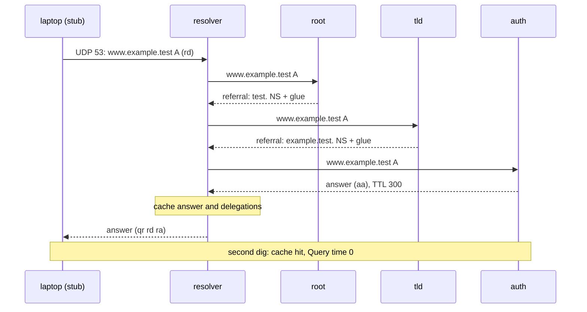
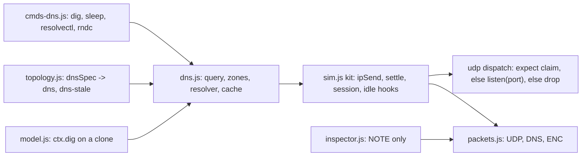

# Network Quest phase 2 (DNS) design

Date: 2026-11-01. Status: design approved; PRs B, C, D pending. Line numbers and `path:line` facts are as of `cd80fac`; PRs B, C and D re-check them before relying on them. Phase 1 design: `docs/superpowers/specs/2026-10-20-net-quest-design.md`. Plan: `docs/superpowers/plans/2026-11-01-net-quest-phase2-dns.md`.

## 1. Goal and summary

Teach DNS by running it: a learner types `dig` on `laptop`, reads the query and the answer in the packet panel, then follows the same question down a real chain of servers.

- **Shape.** stub (`laptop`) → recursive resolver → root → TLD → authoritative. Names live under `*.example.test`.
- **Chapters.** Two new chapters at indexes 5 and 6 (mission keys `5.x` and `6.x`): "Names and DNS" and "Resolvers and caches". 18 missions, 10 XP each, 180 XP. Keys `0.x` to `4.x` and the save key `net-quest-v1` are unchanged.
- **New engine pieces.** UDP and DNS packet layers, a DNS model (`engine/dns.js`), the commands `dig`, `sleep`, `resolvectl` and `rndc` (`engine/cmds-dns.js`), two scenarios (`dns`, `dns-stale`), per-device command gating, inspector notes.
- **Layers, not rewrites: partly true.** The phase 1 spec (line 23) says later phases add layers to `packets.js` and new commands, not rewrites. That was not fully true for this phase: `sim.js` gets four small seams (section 4). No ICMP or ARP behaviour changes, and a test pins their bytes.

Delivery is four PRs (section 13): this docs PR (A), the engine (B), chapter 6 (C), chapter 7 (D).

## 2. Decisions

| # | Decision |
|---|---|
| A1 | Scope of this PR is the spec and the plan only. Building comes in later PRs. |
| A2 | One docs PR, two commits, spec first. |
| A3 | Per-device `AVAIL` gating for the four new commands only (`dig`, `sleep`, `resolvectl`, `rndc`). The general problem, issue #43 (`help` teaching order, replay cost, simulator edge cases), stays its own issue. |
| A4 | "As built" notes live in this spec only. The phase 1 spec gets two one-line pointers (status line, roadmap item 2) and nothing else. |
| A5 | NAT for UDP is left to phase 3. TCP fallback is out. `+trace` is in (mission 6.8, droppable if the chapter runs long). |
| A6 | Chapter PRs C and D rebase on whichever of #41 and this work lands first (both touch `tests/smoke.mjs` and the README). |
| A7 | Two chapters, 18 missions, 9 each. |
| A8 | Ranks: Name Finder 360, Cache Keeper 460, Packet Whisperer 500. |
| A9 | Learner zone editing and `ping` by name are out; both are follow-up issues. |
| A10 | The direct stub→resolver model is kept and stated in mission 5.8 and in "As built". It is not a local stub at 127.0.0.53. |

## 3. Scenarios and addressing

`dnsSpec(opts)` in `topology.js` builds two scenarios, appended to `SCENARIOS`: `dns` and `dns-stale`. They differ only in the resolver's seeded cache. `pair`, `office` and `home` are untouched. There is no NAT and no `dropPrivate`. `me` is `laptop`.

| Device | Interface | Prefix | Route |
|---|---|---|---|
| `laptop` | eth0 | 192.168.1.10/24 | default via 192.168.1.1 |
| `resolver` | eth0 | 192.168.1.53/24 | default via 192.168.1.1 |
| `sw1` | p1 `laptop`, p2 `resolver`, p3 `r1.eth0` | none | none |
| `r1` | eth0 | 192.168.1.1/24 | connected routes only |
| `r1` | eth1 linked to `root.eth0` | 192.0.2.1/24; `root` 192.0.2.10/24 | `root`: default via 192.0.2.1 |
| `r1` | eth2 linked to `tld.eth0` | 198.51.100.1/24; `tld` 198.51.100.10/24 | `tld`: default via 198.51.100.1 |
| `r1` | eth3 linked to `auth.eth0` | 203.0.113.1/24; `auth` 203.0.113.10/24 | `auth`: default via 203.0.113.1 |

Seven devices: `laptop`, `resolver`, `sw1`, `r1`, `root`, `tld`, `auth`.

**Zone data** (answer addresses are not devices):

- `www.example.test` A 198.18.0.80 (198.18.0.0/15 benchmark range) and AAAA 2001:db8::80.
- `shop.example.test` CNAME `www.example.test`.
- MX `10 mail.example.test.` owned by `example.test.`, plus `mail.example.test` A 198.18.0.25.
- `root` delegates `test.` to `tld`; `tld` delegates `example.test.` to `auth` with glue; `auth` holds the records. TTL is 300 on the records the missions read.

**Zone table.** Glue addresses match the addressing table above.

| Zone | Held by | NS (target → glue) | SOA TTL | SOA minimum |
|---|---|---|---|---|
| `.` (root hints) | `root` | `a.root-servers.test.` → 192.0.2.10 | 300 | 60 |
| `test.` | `tld` | `a.nic.test.` → 198.51.100.10 | 300 | 60 |
| `example.test.` | `auth` | `ns1.example.test.` → 203.0.113.10 | 300 | 60 |

- `root` delegates `test.` to `a.nic.test.` and `tld` delegates `example.test.` to `ns1.example.test.`; each referral carries the glue address from the table.
- The negative-cache TTL for NXDOMAIN and NODATA is min(SOA TTL, SOA minimum) = 60 s, so the 5.7 case is testable.

**`dns-stale`** seeds the resolver cache with `www.example.test A 198.18.0.99`, `expires:3600` (absolute; `now` starts at 0). The `auth` zone says 198.18.0.80. Missions 5.0 to 6.6 run on `dns` with an empty cache, so the stale entry never shows there.

**Step budget.** A cold resolution is estimated at about 45 to 70 simulator steps (hand count; PR B measures). PR B's tests assert under 150 and record the measured count. `STEP_LIMIT` stays 500.

## 4. Module seams

**`packets.js`.**

- New: `udp(sport, dport)`, `dns(fields)`, `PROTO.UDP = 17`, `ENC.UDP`, `ENC.DNS`. The `ENC` interface `(fields, body)` is unchanged.
- UDP length is derived from the body. The checksum is zero (legal for IPv4); a pseudo-header checksum would change the `ENC` interface.
- DNS uses the real wire format: 12-byte header, label-length names, no compression, `tc` 0.
- ICMP, ARP and IPv4 bytes are identical to today (test).

**`sim.js`: four seams, no ICMP or ARP behaviour change.**

1. `NQ.sim.udp.listen(port, fn)`: a port-service registry.
2. `NQ.sim.udp.expect(ctx, devId, port, fn)`: a claim for one device and port in this session.
3. `session()` gets an `ext: {}` bag, and `settle` runs idle hooks beside `lost()`.
4. `NQ.sim.kit` exports `ipSend`, `settle`, `session`, `layer`, `ownIface`, `nextHop`.

**UDP dispatch** runs in `ipRx`, before the `if(!ic)` drop. A UDP datagram at its destination device:

1. goes to an `expect` claim for that device and `dport` in this session (this covers dig's source port, `33000 + hash % 1000`, and the resolver's outgoing query ports);
2. else goes to the `listen` service for `dport`; the DNS service on port 53 runs only if the device has a DNS server or resolver role, else it returns false;
3. else is dropped and logged "no one is listening on UDP port N". No reply, no ICMP. An unsolicited datagram is a silent drop.

A resolver reply must match a pending upstream query on (source IP, destination port, id); otherwise it falls to rule 3.

**ICMP errors for UDP senders.** A router that drops UDP sends an ICMP error with id 0 (existing `died` → `icmpError` path). It reaches the sender as an ordinary "delivered: ICMP ..." entry, matches no claim and does not change `status`. `dig` stays a timeout. A test pins this.

## 5. Engine: `engine/dns.js`

New file, loaded after `sim.js`. `NQ.dns.query(net, from, {server, name, type, rd})` returns `{status: 'ok'|'timeout', msg, server, entries, steps, ms}`. It hides:

- **Zone lookup.** Longest-origin zone wins. An exact name gives an answer with `aa`. An NS cut gives a referral with glue. CNAME is followed in-zone. NODATA and NXDOMAIN carry the SOA. A name outside every zone gets REFUSED.
- **Resolver.** Checks the cache, starts at the nearest cached delegation (else the root hints), follows referrals, follows a CNAME up to 8 deep, then answers SERVFAIL.
- **Cache.** Three kinds of entry: positive, negative and delegation. The negative TTL is min(SOA record TTL, SOA minimum), per RFC 2308.
- **Determinism.** `id` is a 16-bit FNV hash of name, type and server. `Query time` is 12 ms per upstream query the queried server sent while answering, and 0 when it answers from its own data or cache. No `Math.random`, no `Date.now`.
- **Continuation.** In-flight queries live in `ctx.ext.dns.pending`, keyed `resolver|serverIp|id` (client address, port, id, question). They last one `settle` and never survive `clone`. When the queue is empty with queries still pending, the idle hook makes the resolver answer SERVFAIL to its client (mirrors `lost()`). Each round removes entries, so the loop ends.
- **Failure path.** `dig` tries once. With no answer it prints `;; communications error to S#53: timed out` and `;; no servers could be reached`, and exits 9.

**Device `dns` data** (plain JSON, written by `topology.js` only when a scenario sets it, so existing devices stay byte-identical):

- stub: `{resolver, roots}`
- resolver: `{recursive: true, roots: [ip], now: 0, cache: [{name, type, expires, rcode, rrs}]}`
- name server: `{zones: [{origin, soa, records: [{name, type, ttl, data}]}]}`

`model.js` `makeCtx` gains `dig(from, name, type, opts)`, which runs on a clone like `ping`, so a mission check can probe without changing the learner's log or caches.

## 6. Commands: `engine/cmds-dns.js`

All formatting lives here.

- **`dig [@server] name [type] [+short] [+norecurse] [+trace]`**, BIND-style output: header (opcode, status, id, flags, counts), question, answer, authority, additional, `Query time`, `SERVER`, `MSG SIZE`. No `WHEN`. Types: A, AAAA, CNAME, NS, MX, TXT. NXDOMAIN and NODATA exit 0.
- **`rd` warning.** `rd` (recursion desired) is set by default. Sent to a server that is not a resolver, the reply has flags `qr aa rd` (or `qr rd` for a referral), no `ra`, and `dig` prints `;; WARNING: recursion requested but not available`. Missions 6.1 to 6.3 explain it.
- **`+norecurse`.** On a cache miss it behaves like BIND: NOERROR, an empty answer, a referral to the nearest cached delegation (else root hints), flags `qr ra`, Query time 0. On a hit it answers from the cache.
- **`+trace`.** Client-side, from the stub's `dns.roots`, one session per hop. Every hop is sent with `rd` off, so there is no warning. The sim skips real dig's first `. NS` query, and the stub-held `roots` list is a simplification. Both are listed under "As built".
- **`sleep N`.** Advances `dns.now` by N seconds on every device with a `dns` field. Real `sleep` blocks; the sim returns at once.
- **`resolvectl dns <iface> <ip>`.** Sets the stub's resolver.
- **`rndc flush`.** Clears the resolver's cache.

Learner editing is only `resolvectl dns` and `rndc flush`.

## 7. Time model, NAT and UDP

**Time.** Cache expiry runs on device `dns.now` (seconds). `net.clock` stays the log-step counter and is untouched. `applySetup` and `reset` zero only `net.clock`, so a cache warmed in mission setup keeps its TTL and its clock. `topology.test.mjs:147` and `sim-local.test.mjs:164-170,216` stay valid.

**NAT and UDP.** The `dns` scenarios avoid NAT. UDP that reaches a NAT router is still dropped ("NAT cannot translate this protocol"). The limit is documented and tested; phase 3 lifts it.

## 8. Gating

`NQ.AVAIL[name](dev)` is checked by dispatch, by `help` and by `suggest()`:

- `dig` and `sleep`: the device has a `dns` field.
- `resolvectl`: the device is a stub (`dns.resolver` exists).
- `rndc`: the device is a recursive resolver.

Chapters 1 to 5 have no `dns` device, so `dig` is never in their `help` and `dog` does not suggest `dig`. Where a command is unavailable the shell says `command not found`. The general fix for #43 stays a separate issue (A3). The new commands' `help` text avoids DNS terms. The effect on `shell.test.mjs` `help` assertions is estimated; PR B reads and fixes them.

## 9. Inspector fields

Flat scalars, so the inspector's field list renders without nested sections: `id`, `qr`, `opcode`, `aa`, `rd`, `ra`, `rcode`, `qname`, `qtype`, `ancount`, `nscount`, `arcount`, and records `an1` to `an3`, `ns1` to `ns2`, `ar1` to `ar2` written like `www.example.test. 300 IN A 198.18.0.80`. Only present fields render. `ENC.DNS` parses the strings back with one shared record parser. `inspector.js` gets a `NOTE` for `UDP` and `DNS` only; `ui.js` `KIND` is unchanged.

## 10. Missions

10 XP each, one idea per card. A question's computed answer never appears in card text (`content.test.mjs:57`). The "Q (computed)" column is the expected value for tests and authors; it is not card text.

| Key | Mission | Idea | Q (computed) |
|---|---|---|---|
| **Chapter 6 "Names and DNS"** | on `laptop`, scenario `dns` | rank title "Name Finder", earned at 360 XP (after 5.3) | |
| 5.0 | `dig www.example.test` | DNS, resolver | the address |
| 5.1 | read the answer line | record, A, `IN` | seconds the answer may be kept (300) |
| 5.2 | run `dig www.example.test` first, then read the query in the packet panel | UDP and port | destination port |
| 5.3 | `dig +short www.example.test` | terse output | none (check: the line ran) |
| 5.4 | `dig example.test MX`; the MX record `10 mail.example.test.` is owned by `example.test.` | asking for a type | the mail server's name |
| 5.5 | `dig example.test NS` | NS | the NS name |
| 5.6 | `dig shop.example.test` | CNAME | canonical name |
| 5.7 | `dig wwww.example.test` (typo) | NXDOMAIN, status; SERVFAIL and REFUSED defined in place | records in the answer section (0) |
| 5.8 | fix-it: laptop points at a dead resolver; `resolvectl dns eth0 192.168.1.53`, then `dig`. The card says this laptop asks the resolver direct (the resolver address is set with `resolvectl dns`), whereas real systems often put a local helper at 127.0.0.53 that forwards to the same server | `resolvectl` | none (check: probe `ctx.dig` ok) |
| **Chapter 7 "Resolvers and caches"** | scenario `dns` (6.7 on `dns-stale`) | rank title "Cache Keeper", earned at 460 XP (after 6.4) | |
| 6.0 | who did the legwork | recursive resolver, root server | address of the first server it asked |
| 6.1 | `dig @192.0.2.10 www.example.test`; teaches `@server`, referral and `rd` with the warning | `@server`, referral, `rd` | referred server's name |
| 6.2 | `dig @198.51.100.10 www.example.test` | TLD, glue | glue address |
| 6.3 | `dig @203.0.113.10 www.example.test`; `ra` stays here; the authoritative reply carries `rd` but no `ra`, so `ra` is taught by contrast with the resolver's reply | authoritative, flags `aa` `ra` | two-letter flag for "I own this answer" |
| 6.4 | ask twice | DNS cache | second query time (0) |
| 6.5 | `dig +norecurse`, before and after a normal `dig` | peek at the cache | address returned once cached |
| 6.6 | `sleep 120`, then `dig`; the card says the practice shell skips the wait | DNS TTL counts down | new TTL (180) |
| 6.7 | fix-it on `resolver`, scenario `dns-stale` | `rndc flush` | none |
| 6.8 | `dig +trace www.example.test` | whole chain | name of the last server asked |

Notes on specific missions:

- **6.1 and `rd`.** `rd` taught in 6.1, together with the warning; `ra` stays in 6.3.
- **6.6 setup.** Setup warms the cache with `dig www.example.test` on `laptop`; the clock and cache are kept through setup. After `sleep 120`, `dig` shows a TTL of 300 minus seconds since cached (180). The check computes the expected TTL from the net, and past 300 s the entry expires, so the next `dig` shows 300.
- **6.7 check.** `ctx.dig('laptop', 'www.example.test')` on a clone returns the `auth` zone's address. Doing nothing fails (the stale 198.18.0.99 is returned). `sleep 3600` also passes: the check is on the outcome.
- **Answer `0` in 5.7 and 6.4.** The card text of both (goal, explain, hint, how, ask) must not contain the word `0`, because `content.test.mjs:57` forbids a question's computed answer there. The rule binds the text written in PRs C and D, not the table above.
- **5.4 card text** never names `mail.example.test`. The question asks for "the mail server's name".
- **Guide and quick-fire.** AAAA and TXT appear in guide and quick-fire, not in missions. Each chapter gets 4 guide entries and 6 quick-fire questions (`ch:5`, `ch:6`). SERVFAIL is in 5.7's explain and in a quick-fire question.
- **Replay.** 5.0 to 6.6 start with an empty cache on `dns`; only 6.7 uses `dns-stale`.

## 11. Teach-before-use

New `FIRST` rows in `teach.test.mjs`, written as term → key:

- DNS → 5.0
- resolver → 5.0
- record → 5.1
- A record → 5.1
- UDP → 5.2
- qname → 5.2
- `+short` → 5.3
- MX → 5.4
- NS → 5.5
- CNAME → 5.6
- alias → 5.6
- NXDOMAIN → 5.7
- status → 5.7
- SERVFAIL → 5.7
- REFUSED → 5.7
- `resolvectl` → 5.8
- recursive → 6.0
- root server → 6.0
- `@server` → 6.1
- referral → 6.1
- `rd` → 6.1
- TLD → 6.2
- glue → 6.2
- authoritative → 6.3
- `aa` → 6.3
- `ra` → 6.3
- DNS cache → 6.4
- `+norecurse` → 6.5
- DNS TTL → 6.6
- `sleep` → 6.6
- `rndc flush` → 6.7
- `+trace` → 6.8

The bare word "port" is already used in chapter 2, so its regex is `UDP port`. "TTL" already means the packet TTL (chapter 1), so the regex is `DNS TTL`, defined in place against it. Two new "does not use later terms" blocks cover chapters 6 and 7; the chapter 5 block already forbids DNS, UDP and TCP.

## 12. Ranks

Final: `[0,80,190,250,290,360,460,500]`, 8 ranks, total 500. Interim after PR C: `[0,80,190,250,290,360,410]`, 7 ranks, total 410. The interim top rank at 410 keeps the title Packet Whisperer; PR D inserts Cache Keeper at 460 and moves Packet Whisperer to 500.

- Name Finder 360.
- Cache Keeper 460: earned after 6.4, once caching is taught. It still passes the ≤470 rank rule (PR D re-checks the rule in `content.test.mjs`).
- Packet Whisperer 500.

| Point | Total XP |
|---|---|
| Chapters 1 to 5 (keys `0.x` to `4.x`) | 320 |
| After PR C (keys `5.0` to `5.8`) | 410 |
| After PR D (keys `6.0` to `6.8`) | 500 |

## 13. Delivery

| PR | Contents |
|---|---|
| A (this PR) | Docs only: this spec and the plan (two commits, spec first), plus two pointer lines in the phase 1 spec. |
| B | Engine: layers, `sim.js` seams, `dns.js`, `cmds-dns.js`, both scenarios, `AVAIL` gating, inspector `NOTE`, tests. No chapter. |
| C | Chapter 6 (9 missions), quick-fire, guide, interim ranks `[0,80,190,250,290,360,410]`, test and smoke updates. |
| D | Chapter 7 (9 missions), final ranks with Cache Keeper at 460, README (five → seven chapters), landing card "7 chapters", AGENTS.md row, this spec's "As built" completed. |

Each PR ends with the `pre-pr-check` skill. UI checks for C and D: desktop (1280) and 390px screenshots, the 7-device `dns` layout, and all 18 mission cards.

## 14. Tests to change

Fixtures under `tests/fixtures/` are untouched.

- `tests/net/topology.test.mjs:7` (the `names` array): append `'dns'`, `'dns-stale'`.
- `tests/net/content.test.mjs:689-704`: total 320 → 410 (C) → 500 (D); ranks 6 → 7 → 8. Line 44 needs exit 1 for `expectFail` lines and 0 for all others, and a timed-out `dig` line stays out of `answer`; no change to the test.
- `tests/net/teach.test.mjs`: `FIRST` rows and two describe blocks (section 11).
- `tests/shell/codestyle.test.mjs:9-10` (the `SAFE` and `AMBIG` command lists): add `resolvectl` and `rndc` to `SAFE` (not English words) and `dig` to `AMBIG` (an English word, checked only before a verb); `sleep` is already in `AMBIG`.
- `tests/net/shell.test.mjs`: `help` and `suggest` per device, including the `dog` case.
- `tests/net/harness.mjs` `FILES` and `net-quest/index.html`: `dns.js` after `sim.js`, `cmds-dns.js` after `cmds-net.js`, `ch-6-dns-basics.js` and `ch-7-resolution.js` before `extras.js`.
- `tests/smoke.mjs` about lines 1692 and 1792: five → seven chapters, chapter 6 and 7 play-through, 390px.
- New: `dns.test.mjs`, `cmds-dns.test.mjs`, `sim-udp.test.mjs`.
- `packets.test.mjs`: UDP and DNS hex, and the byte-identity test for ICMP, ARP and IPv4.

Line numbers are from the files as of `cd80fac`; the PRs re-check them.

## 15. Out of scope

- PRs B, C and D themselves.
- General #43 (`help` teaching order, replay cost, simulator edge cases). Only per-device gating for `dig`, `sleep`, `resolvectl` and `rndc` is in phase 2.
- Learner zone editing (follow-up issue).
- `ping` by name (follow-up issue).
- NAT for UDP (phase 3).
- TCP fallback, EDNS, PTR and `-x`, wildcards, DNSSEC, a stub-side cache, and a local stub at 127.0.0.53.
- Loopback delivery: `dig @<own IP>` times out where real dig says "connection refused" (phase 3).
- The fix for ICMP errors with id 0 for non-ICMP packets (phase 3).
- Edits to `index.html`, README, AGENTS.md, `app.js`, tests or `net-quest/**` in this PR. PR D does the docs wiring.

## 16. Alternatives (why they lost)

- Time as `net.seconds`: changes `topology.test.mjs:147` and the `net` shape.
- Redefining `net.clock`: breaks `clock === log.length`.
- A per-device pending table: never survives `clone`.
- Synthetic log entries: breaks "real packets" (phase 1 spec, line 28).
- A new device kind `dns`: changes `RX`, `KIND` and `NQ.exec` for nothing.
- NAT for UDP now: ports, `snat`, `natBack`, the printer and `sim-nat` tests; phase 3.
- Reusing the `home` scenario: changes the asserted device lists of chapters 1 to 5.
- A stale cache via a test-only setup command: a command real systems lack, hidden from `help`.
- A stale cache via a mission seed field: the runner and `createNet` both need it.
- UDP dispatch by port only: cannot serve ephemeral ports.
- ICMP port-unreachable: needs ICMP encoder and matching changes; phase 3.
- A pseudo-header checksum: changes the `ENC` interface.
- Nested inspector sections: render as `[object Object]`.
- Resolver-side `+trace`: the learner sees nothing new.

## 17. Risks

- The step budget (45 to 70) is a hand count; PR B measures it.
- The 390px layout of the 7-device scenario is unseen; the desktop column order needs a look. Servers show as "computer" in diagram labels (cosmetic).
- `AVAIL` gating changes dispatch for four commands; the `shell.test.mjs` `help` assertions were not read in full.
- Phase 3 may want a net-level seconds counter; moving `dns.now` there is a small migration.
- 18 mission cards are the main effort; PR B is roughly 600 to 900 lines plus tests.
- `content.test.mjs:57` forbids computed answers in card text. Cards for the port (53) and the flag (`aa`) describe the idea without naming the value; the PR C and D tests catch slips.
- Rank regression: learners who finished the five chapters drop from "Packet Whisperer" to "NAT Navigator" until they finish DNS. XP is derived and saves are untouched.
- Several files were read only by search: `app.js`, `ui.js`, `cmds-ip.js` and most test bodies. The PRs re-check every cited line.

## As built

Seeded in PR A; PR D completes it.

- The home NAT scenario drops non-echo traffic, so UDP over NAT is phase 3.
- ICMP errors for UDP senders carry id 0. `dig` ignores them, and phase 3 owns the fix.
- The direct stub→resolver model (A10) means `SERVER:` prints the resolver address, where real systemd-resolved prints 127.0.0.53.
- `+trace` sends every hop with `rd` off (no warning). The sim skips real dig's first `. NS` query, and the stub holds `roots`.
- `dig` makes no retries and prints no `WHEN`.
- `dig @<own IP>` times out: there is no loopback delivery.
- The UDP checksum is zero and DNS has no name compression.
- `dns.now` is per device; phase 3 may move it to a net-level counter.

## 18. Diagrams

