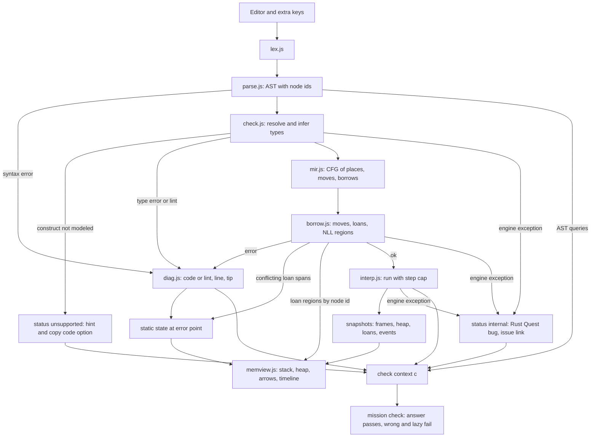
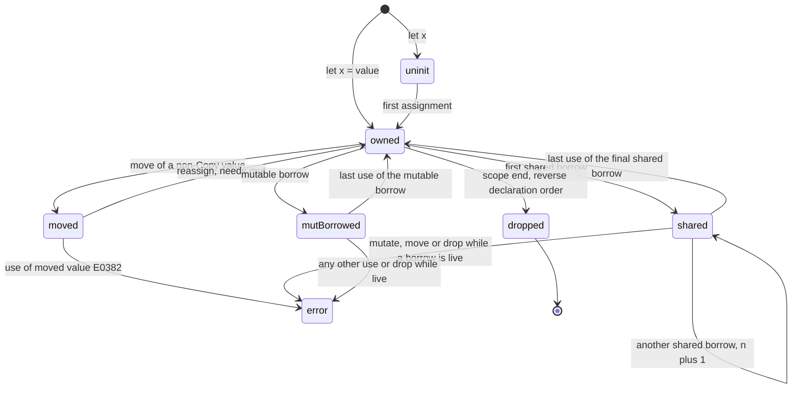

# Rust Quest (`rust-quest/`) design

Date: 2026-11-01. Status: approved design, nothing built yet. Issue: #47.

> **Rust facts are UNVERIFIED until the first verify run (P2).** Error codes, lint names and folding behaviour, the panic header format, thread-id presence, exit codes, `f64` formatting and edition 2024 behaviour are authored from memory. `tests/rust/verify-rustc.mjs` settles them against a real `rustc`. Nothing in this spec is a claim about `rustc` until then.

## Goal

A new playground that teaches Rust, with ownership and borrowing at the centre. Learners write small real Rust programs in the browser. The quest checks them with an in-repo checker and interpreter that reports the same diagnostic ids a real `rustc` reports, runs the ones that compile, and draws a memory view (stack, heap, arrows, drops) so the compile-time rules can be seen. Same quest format as the others: chapters of missions with honest checks, quick-fire, field guide, XP and ranks. No network, no install.

Success means the learner can predict whether a program compiles and why, write small programs with structs, enums, collections, errors, traits and iterators, and read a borrow-checker message without panic.

## Decisions

Owner decisions, closed. Later PRs follow them.

| # | Decision |
|---|---|
| D1 | **Runtime: option B**, an in-repo interpreter and checker. |
| D2 | **Rule 2:** no network. The quest works offline and opened from disk. |
| D3 | **Scope:** real code through P12. P13 and P14 are decided at checkpoint 2. |
| D4 | **Diagnostics:** wording is authored, ids are real. A banner names the `rustc` version and edition from `verified.json`. Target edition 2024, confirmed by the verify run's `rustc`. |
| D5 | **`rust` commit scope** goes in its own `ci:` PR (P0), with a rebase on conflict. |
| D6 | **PR chain:** the Agent chain applies, with engine PRs inserted (see PR chain). The owner applies the `pre-pr-check` edit in P3 if the sandbox denies it. |
| D7 | **Persistence:** learner code in the main saved state as `codes`, with a per-mission cap and a "reset to starter" button, like C++ Quest. |
| D8 | **Go (#48)** is decided separately. This spec records "no WASM, no new host". |
| D9 | **`rustc` check:** a "Copy code" button plus a link to the bare Playground. The learner's code is never put in a URL. |
| D10 | **Verification run:** the owner runs `tests/rust/verify-rustc.mjs` locally on every corpus or mission change. CI only recomputes hashes. A rustup CI step is a separate decision. |
| D11 | **Corpus:** authored programs modeled on Rust Book scenarios, with `rustc` as ground truth. |
| D12 | **Course shape:** one linear path, no Tiers in v1. |
| D13 | **`HashMap` order:** deterministic scramble plus the two-seed rule (see Check context). |
| D14 | **Bundle size:** measure at P2 and P5 and set a budget in this spec (see Bundle size). |
| D15 | **`unsupported` in a mission:** hint, copy and Playground option, feature-request footer, no completion. No skip, no self-verified "mark done". |
| D16 | **Ranks ladder top title:** named in P2 (#65), not in this spec, because the name is written together with the chapter content there. |

## Recommendation

### Runtime
Build `rust-quest/engine/`, a DOM-free engine in plain JS that runs the learner's real Rust source.

- Pipeline: lexer, parser, name resolution and type inference, lowering to a small CFG, move and borrow pass (NLL-lite), tree-walk interpreter, snapshot recorder.
- No new host, no WASM, no new dependency, no build step.
- It follows C++ Quest's approach (`cpp-quest/app.js`, `const CPP=(()=>{…`), split into files as Net and Agent Quest do (hard rule 6).
- Rust differs from C++ because the core lesson is compile-time, so the quest needs a type pass and a borrow pass before any run.

**Three kinds of non-verdict.** They are kept separate on purpose:
1. `unsupported`: a construct the engine deliberately does not model.
   - A program using one gets `status:'unsupported'` with the feature name and line.
   - The mission is neither completed nor failed.
   - The card shows "Rust Quest doesn't model `<feature>`" plus a hint from the `diag.js` unsupported catalog that names the in-subset way. For example, `HashSet` becomes `HashMap<T, ()>` or `Vec` with `contains`; `.windows()` becomes an index loop; a capturing closure before ch12 becomes "pass the value as a parameter".
   - It also offers "Copy code" and the bare Playground link (D9), and the feature-request footer from `shared/nav.js`.
   - Each chapter shows a "toolbox" line listing the std items and constructs available there.
   - Every mission has at least one alternative valid answer that must pass (`docs/tiers-guideline.md:260,262`).
2. `internal`: an engine exception on code the engine should handle.
   - It reports `status:'internal'` and the message "This is a Rust Quest bug, not your code".
   - It gives a link to open a feature-request footer issue with no learner code in the URL.
   - It never completes a mission and never points to a workaround.
   - A test asserts that no corpus program, mission program or fuzz seed returns `internal`.
3. A verdict (`ok`, `error`, `panic`, `limit`, `exit`) is given only for programs whose constructs are all modeled.

The verdict policy covers missing constructs only. It does not cover a checker bug on supported constructs. The safeguards for that are the verified corpus (minimal pairs and combination programs) and the stamp (see Fidelity proof). Residual risk stays.

### Subset boundary per topic

| Topic | In (runs real code) | Out (reports `unsupported`) |
|---|---|---|
| Variables, mutability | `let`, `mut`, shadowing, `const`, E0384 | `static mut`, `unsafe` |
| Types | `i8..i64`, `u8..u64`, `isize`, `usize`, `f64`, `bool`, `char`, `&str`, `String`, tuples, `[T;N]`, `&[T]`, inference with default `i32`/`f64`, `as` | `i128`/`u128`, `f32`, `!`, raw pointers |
| Arithmetic | Runtime overflow panic as in a debug build. Compile-time lints `arithmetic_overflow`, `unconditional_panic`, `overflowing_literals` (deny by default, no E-code). | const-eval beyond literals and single-assignment immutable lets |
| Formatting | `{}`, `{:?}`, `{:.N}`, `{:>N}`. The engine has its own `f64` `Display`/`Debug` and rounding code, not JS `toString`/`toFixed`. | `{:#?}`, `{:e}`, `{:x}` |
| Functions, control flow | `fn`, tail expression, `if`/`loop` as expressions, `while`, `for` over ranges and collections, `break` with a value, labels | `const fn`, `async` |
| Structs, enums, `match` | struct, tuple and unit struct, enums with data, inherent `impl`, `self`/`&self`/`&mut self`, associated fns, `#[derive(Debug)]`, patterns (literal, range, binding, tuple, struct, enum, `_`, guard, `@`), `if let`, `while let`, `let else`, E0004 | nested module visibility, `union` |
| `Option`, `Result`, `?` | both types and non-closure methods (`unwrap`, `expect`, `unwrap_or`, `ok_or`, `is_some`, …), `?` with the same error type, `main -> Result<(), E>` (prints `Error: {:?}`, exit 1), `panic!` (exit 101) | `?` with a `From` conversion before ch11, `Box<dyn Error>`, `anyhow`, `thiserror` |
| Ownership, borrowing | move, Copy vs Clone, drop order, `&`/`&mut`, aliasing XOR mutation, NLL, two-phase borrows, reborrows, disjoint fields, slices, E0106/E0515/E0597 | Polonius-only cases, `Rc`/`Arc`/`RefCell`/`Mutex`, `unsafe`, `Pin` |
| Lifetimes | `'a` on fns and structs, elision, `'static`, E0106 with annotation fix | `'a: 'b`, HRTB, `dyn Trait + 'a`, variance |
| Collections | `Vec`, `String`, `HashMap` common non-closure methods, `for` over `&v`, `&mut v`, `v.iter()`, map iteration as a deterministic scramble | `HashSet`, `VecDeque`, `BTreeMap` (cheap to add later), `Cow` |
| Traits, generics (P13) | user type-parameter generics, user traits, default methods, `impl Trait for T`, `Display` via `write!`, `From` and `?` conversion, `Drop`, bounds, `where`, `impl Trait` args, static dispatch, all derives | `dyn Trait`, associated types except `Iterator::Item`, operator overloading, const generics, blanket impls |
| Closures, iterators (P14) | closure typing and capture analysis, `move`, `Fn`/`FnMut`/`FnOnce` errors, native lazy adapters, `collect` (needs an annotation, else E0283), user `impl Iterator`, closure-taking `Option`/`Result`/`Vec` methods | `impl Fn` returns, `Box<dyn Fn>`, `peekable`, `windows`, `chunks` |
| Program model | `println!`, `print!`, `eprintln!`, `format!`, `assert!`, `assert_eq!`, `vec!`, `panic!`, `todo!`, `std::process::exit` | stdin, `dbg!`, user macros, threads, files, `env` |

Execution limits: main thread, synchronous, a step cap (precedent `cpp-quest/app.js:838`) and a recursion-depth cap reported as a stack-overflow abort. No Web Worker, because it needs a separate file or Blob and fights inlined bundling.

The panic header format, exit codes (101, 1, `process::exit`), the overflow-panic text, and the `f64` `Display`/`Debug` rules are not authored truth. The verify run settles them (see Fidelity proof). `diag.js` keeps the panic header in one constant, with its normalization rules listed in this spec.

### Type-checker features, by the PR that first needs them

| PR | New engine and type-checker features |
|---|---|
| P2 | lexer, parser for the full subset grammar (anything outside the subset parses, then reports `unsupported`), scalar literals, `let`, `fn`, `println!` with `{}`, `Fn`-bound syntax in std signatures parses |
| P4 | inference of int/float literals, tuples, arrays, `as`, `if`/loops, `Range` as a built-in iterable, formatting, E0308/E0384/E0425, the three lints |
| P5 | Copy classification table, reference types with region variables, deref coercion (`&String` to `&str`), `String` std signatures, CFG lowering, move analysis, NLL loans |
| P6 | minimal structs (declaration, construction, field access, field drop order) and a single-method `impl Drop` special case, so drop order can be verified against `rustc` |
| P7 | slice types, lifetime elision check, E0106/E0515 |
| P8 | enums, inherent `impl`, generic instantiation of builtin items (`Option`, `Result`, `Vec`, `HashMap`), builtin trait lookup (`Copy`, `Clone`, `Debug`, `PartialEq`, `Eq`, `PartialOrd`, `Default`, `Hash`, `IntoIterator`), method resolution with autoref and autoderef, derives, field place paths in the borrow pass. A call with a closure argument reports `unsupported` until P14. |
| P9 | patterns, exhaustiveness, E0004 |
| P10 | `for` desugaring over `IntoIterator` for `Vec`, `&Vec`, `&mut Vec`, `HashMap`, `Range`; two-phase borrows; non-closure collection signatures; the formatter and `HashMap` traversal share one entry point |
| P11 | `Result`, `?` with identical error types, `main -> Result` |
| P12 | explicit lifetime annotations, region constraints, E0597 with regions |
| P13 | user type-parameter generics, user trait declarations, default methods, user `impl Trait for Type` (general `Drop`, `Display`, `From` and `?` conversion), bound checking (E0277/E0599/E0369), `impl Trait` args |
| P14 | closure typing, capture analysis, `move`, `Fn`-kind errors (E0525/E0373), iterator adapters, closure-taking std methods, user `impl Iterator` |

Closures and adapters moved to P14 because no chapter before ch12 needs them (see Chapters). That is also why checkpoint 2 saves more.

### Check context, answer / wrong / lazy

```
c.status        'ok' | 'error' | 'unsupported' | 'internal' | 'panic' | 'limit' | 'exit'
c.errors        [{code?, lint?, line, col, msg}]    // code or lint, never both
c.stdout  c.stderr  c.exit  c.panic{msg,line}  c.unsupported{feature,line}
c.hashIterated  // set when any HashMap traversal ran (see two-seed rule)
c.events        [{t:'move'|'borrow'|'endborrow'|'drop'|'alloc'|'free', kind, ...}]
c.compiles()  c.hasError(id, line?)  c.onlyError(id)     // id is a code or a lint name
c.out()  c.dropOrder()  c.moved(name)  c.maxLive('mut'|'shared')
c.allocs(kind?)                                        // heap alloc events
c.calls(name)  c.usesType(name)  c.usesMacro(name)  c.count(kind)  c.paramIsRef(fn, i)
```

`alloc` is one event per owned heap object created (`String`, `Vec`, `Box`, `HashMap`), including those from `format!`, `to_string`, `to_owned`, `String::from`, `clone` and `Clone::clone`. It is not one event per capacity growth.

Mission kinds:
- `write`: the learner writes items. A hidden `harness` supplies `fn main` with extra cases, and the check reads the harness run. The learner's function is called again with other arguments (`docs/tiers-guideline.md:263`).
- `fix`: a `starter` that fails with `starterErr`. Check: compiles, expected output, plus the outcome invariant.
- `predict`: "does it compile, and which error?" Answers come from the engine, so quick-fire can be generated by running snippets (`cpp-quest/app.js:2179`). That holds only while the stamp is current.
- `choose`: authored, for topics the engine does not run.

**Check = construct and outcome**, per `docs/tiers-guideline.md:258,263`. Construct checks (`c.paramIsRef`, `c.calls('for')`) are combined with outcome checks (output, events, alloc counts). They do not replace outcome checks.

**Borrow-lesson checks use events, not syntax.** Example: require `c.paramIsRef('len_of', 0)` and `c.allocs('String') === 1`. Any copy fails, whatever the spelling.

Required `lazy` list for every borrow-lesson mission:
- `.clone()`
- `.to_owned()`
- `.to_string()`
- `String::from(s.as_str())`
- `format!("{}", s)`
- `Clone::clone(&s)`
- deleting the offending line
- returning a constant that matches the visible case
- `Rc`/`unsafe` (reports `unsupported`, so it does not pass)

Tests per mission:
- `answer` passes.
- Every `wrong` and `lazy` fails.
- Every `wrong` fails for its `wrongWhy` (an id or a harness mismatch).
- Every `fix` starter fails with `starterErr`.
- At least one alternative valid answer passes.

**Two-seed rule.**
- Every `HashMap` traversal goes through one engine entry point in `std.js`. It sets `c.hashIterated`. `for`, `iter`, `keys`, `values`, `into_iter` and `extend` use it.
- The `{:?}` formatter's map traversal uses the same entry point, including `{:?}` on a struct that contains a map.
- If the flag is set, the wrapper runs the program a second time with the reversed scramble order and requires the same stdout.
- On a difference the mission fails with the tip "your output depends on `HashMap` order; real Rust changes it every run, so sort the keys".
- Two orders differ for 2 or more keys. A map with 1 key prints the same either way and passes.
- The oracle cannot fix a real order (it is random), so corpus entries that print maps are order-independent. The rule itself is covered by unit tests: `{:?}` on a 2-key map sets the flag and fails the check; `{:?}` on a 1-key map passes; sorted-key output passes.

### Diagnostics: codes and lints
A diagnostic carries `code` (e.g. `E0382`) or `lint` (e.g. `arithmetic_overflow`, `unconditional_panic`, `overflowing_literals`), never both. `diag.js` is keyed by that id and holds authored wording, a beginner `tip`, and a field-guide link.

- Real `rustc` reports a constant overflow (`let x: u8 = 255 + 1;`) as a compile error from a deny-by-default lint. `[1,2,3][5]` and `1/0` are `unconditional_panic`. `let x: u8 = 256;` is `overflowing_literals`.
- Ch2 teaches both. The compile-time form uses literals. The runtime panic takes its values from function parameters: `fn add(a: u8, b: u8) -> u8 { a + b }` called with `250` and `10` from `main`. The lint is intra-function, so this panics at runtime.
- The lint pass models only literals and single-assignment immutable `let`s in straight-line code. Mission programs avoid anything else that rustc's lint might fold.
- The corpus has both lint cases and runtime-panic cases, checked against real `rustc` (see Fidelity proof).

### Memory view model
Two sources feed it:
- Interpreter snapshots (runtime values), recorded at each statement boundary and capped by the step limit.
- Loan regions from the borrow pass: for each loan, the set of CFG points where a derived reference is still live. A loan ends at last use, which is a static fact. The view looks it up by AST node id and shows the loan ended after the last use.

Snapshot shape:

```
{ step, line,
  frames:[{fn, vars:[{name, ty, state, n?, value, heapId}]}],
  heap:[{id, kind, content, owner}],
  loans:[{id, kind:'shared'|'mut', ref, place, live}],
  events:[...] }
```

`state` is `uninit | owned | moved | dropped | shared | mutBorrowed`. `n` is the number of live shared borrows when `state` is `shared`. These are the same names the state diagram uses (see Diagrams).

Rendering (DOM only in `memview.js`): stack on the left, heap on the right, solid ownership arrows, dashed blue `&` and red `&mut` arrows, moved-from variables greyed and struck through, drops in reverse declaration order, a step slider, the source line highlighted. A gutter bar next to the editor shows each loan's live line range. At 390px the stack and heap stack vertically.

A program that fails to compile cannot run, so it gets a static view: "state at the error point". It shows moved or borrowed markers, the conflicting loan spans from the borrow pass, and the error arrow. It is not a timeline.

### Engine file layout
Global namespace `RQ`, loaded in `index.html` script order, like `AQ`.

```
rust-quest/
  index.html  style.css  app.js
  engine/  lex.js  parse.js  types.js  check.js  mir.js  borrow.js
           interp.js  std.js  diag.js  index.js
  content/ model.js  ch-01-*.js … ch-13-*.js  extras.js   (RANKS, QF, GUIDE)
  ui.js  editor.js  memview.js
tests/rust/ harness.mjs (FILES in index.html order)  *.test.mjs  verify-rustc.mjs
tests/fixtures/rust/  corpus-*.json  verified.json
```

- `index.js` exposes `RQ.compile(src)` → `{ast, diags, unsupported}` and `RQ.run(src, opts)` → check-context data.
- An internal exception is caught at the `RQ.run` boundary and returned as `status:'internal'` (see Runtime), never `unsupported`, so the UI does not crash and no learner is sent to a wrong workaround.
- `verify-rustc.mjs` is a dev-only script under `tests/rust/`, not `*.test.mjs`, so `node --test` does not run it. Placing it there avoids a `tools/` PR (`AGENTS.md` flags `tools/` changes as their own PR).
- `index.html` follows the new-playground skill: `window.PROGRESS={key:"rust-quest-v1",name:"Rust Quest"}`, `shared/progress`, `nav` and `how` CSS and JS before `app.js`, `HowSteps.html(m.how)` on the mission card. Every mission has `how`, whole line first. Code in learner text is in `<code>` (hard rules 9 and 10).
- Mobile editor: an extra-keys row with `& &mut ' :: <> |x| { } ; ! ? Tab`, like cpp-quest's.

### Persistence
Facts:
- C++ Quest saves the learner's code in its main state: `S.codes[mkey(S.ch,S.mi)]` and `S.sandbox`, written by `saveCode()`/`save()` (`cpp-quest/app.js:1980`, restored at `:2164`, `:2289`). `snapshot()` exports the whole saved state (`shared/progress.js:51`), so the code goes into exports and linked backups.
- Net Quest saves up to 200 characters of learner text (`net-quest/app.js:29`).
- Agent Quest saves none, because its free-text prompts might carry personal data.

Rust Quest follows C++ (D7): `codes` in the main state, a per-mission length cap, a "reset to starter" button, and a test of the export round trip. `codes` is an added field, not a key rename (hard rule 4). `xp` is saved and the fresh state stays pristine (`shared/progress.js:44`). Exported backups contain learner code.

### Chapters, previews and teach-before-use
It follows the Rust Book order, ownership first. Single linear path (D12). Every term a chapter's missions use was taught earlier, or is a **preview**: a term the quest uses before it is fully taught, introduced in place in the mission that first uses it.

1. **Hello, Rust.** `fn main`, `println!`, `let`, immutability (E0384), `mut`, shadowing.
2. **Types and numbers.** Scalars, inference, `as`, tuples, arrays, `const`, overflow lint vs runtime panic.
3. **Functions and control flow.** Params and returns with scalar types only, tail expression vs `;`, `if`, `loop`, `while`, `for` over ranges, E0308.
4. **Ownership.** Stack vs heap, `String`, move, Copy vs Clone, drop order, ownership through calls. First use of the memory view.
5. **Borrowing.** `&`, `&mut`, aliasing XOR mutation, NLL, dangling (E0106/E0515), `&str` and slices. E0502 uses `String` slices, not `Vec`. E0106's fix is returning an owned `String`; annotations wait for ch10.
6. **Structs and methods.** `struct`, inherent `impl`, `&self`, `&mut self`, associated fns.
7. **Enums, `Option`, `match`.** Exhaustiveness.
8. **`Vec`, `String`, `HashMap`.** E0502 on `push`, entry API, `for x in &v` and `&mut v`. No closures, no adapters.
9. **Errors.** `Result`, `?` with identical error types, `match` on `Result`, `unwrap`/`expect`/`ok_or`, `panic!`, `main -> Result<(), String>`. Custom error enums print with `{:?}`. No `From`, no hand-written `Display`, no closures.
10. **Lifetimes.** Annotations, elision, structs holding references.
11. **Traits and generics.** `trait`, `impl Trait for Type`, `Display`, `From` and `?` conversion, `Drop`, user generics with bounds, `impl Trait` args, `derive` explained.
12. **Closures and iterators.** Closures, captures, `map`/`filter`/`collect` and the other adapters, closure-taking `Option`/`Result` methods, user `impl Iterator`.
13. **Capstone.**

**Previews, each with its in-place wording.** Wording is learner text in the mission, with code in `<code>`.

| Chapter | Term (tag) | Defined in place, wording |
|---|---|---|
| 1 | `!` macro (`macro`) | "The `!` in `println!` marks a macro, a built-in code writer. It isn't a normal function." |
| 1 | `{}` | "`{}` is a hole. `println!` fills it with the next argument." (taught outright in mission 1, not a preview) |
| 2 | `&str` (`ref-type`) | "A string literal has the type `&str`, a view of text. Chapter 5 explains the `&`." |
| 4 | `String::from(..)`, `::` (`path-call`) | "`::` names a function that belongs to a type. Chapter 6 shows how to write your own." |
| 4 | `s.push_str(..)`, `.` (`method-call`) | "`.` calls a function that belongs to the value. Chapter 6 shows how to write your own." |
| 4 | `println!("{}", s)` and `push_str` do not move `s` (`borrow-note`) | "They borrow `s` for a moment and give it back. Chapter 5 explains borrowing." |
| 6 | `#[derive(Debug)]` (`derive`) | "This line asks the compiler to write the `{:?}` printing code for you. Chapter 11 explains traits." |
| 7 | `Option<i32>` (`type-args`) | "The `<i32>` says what's inside. `Option<T>` means `T` stands for any type. Chapter 11 shows how to write your own." |
| 8 | `v.iter()` (`iterator`) | "`iter()` hands the items to a `for` loop one at a time. Chapter 12 shows what else you can do with it." |

Terms taught outright in their own chapter, not previews: `impl`, `&self` (ch6), `lifetime-param` (ch10), `trait-decl`, `trait-impl`, `generic-decl` (ch11), `closure`, `adapter` (ch12).

**How the feature-tag test treats a preview.**
- Each mission lists `defines` (taught here) and `previews` (tag, wording, home chapter). The engine computes feature tags from every program in the mission (`answer`, starter, `wrong`, `lazy`, harness).
- A tag is **taught** from the mission that defines it. It is **previewed** from the mission whose `previews` carries it.
- A tag in a program passes if it is taught earlier. Otherwise it passes only if it is previewed in this mission, or in an earlier one, and the first mission to use it carries the preview.
- A preview counts as in-place definition for that mission and later ones, but never as taught: the test also requires that the term's home chapter exists and comes later.
- The preview wording must contain "Chapter N" with N equal to the home chapter. A test also fails if a mission uses a tag that is neither taught nor previewed, which is what catches `closure`, `generic-decl` and `trait-impl` in chapters 1 to 10.
- The table above lists all previews so reviewers can see them.

Ranks ladder with a fun top title (name set in P2, D16). Quick-fire and field guide are appended with each chapter. The guide includes a glossary of E-codes and lint names.

## Alternatives

Compared on R1 write programs, R2 no install, R3 memory view, R9 no new dependency or host, R10 bundle, determinism and tests. R-numbers are the requirements in issue #47.

| Option | R1 | R2 | R3 | R9 | R10 | Effort |
|---|---|---|---|---|---|---|
| **B. In-repo interpreter and checker (chosen)** | yes, subset | yes, offline | full, owns the trace | none new | deterministic, Node-testable | very large |
| A. Closed-model simulator (Net/Agent style) | no, only authored programs | yes | yes, authored | none | trivial fidelity | small |
| C. Playground API | yes, full Rust | needs network on every run | none (text output only) | third-party host, `SECURITY.md:22` | non-deterministic CI | small |
| D. WASM | see below | see below | see below | see below | see below | see below |

- **A** lost on R1. The ticket says a simulator "cannot run arbitrary code", but R1 is "write small Rust programs".
  - If checkpoint 2 downgrades ch11-12, those chapters become A-style authored lessons.
  - **R1 is then partly unmet.** Learners could not write their own traits, generics with bounds, or closures, and could not use iterator adapters as real code. Ch1 to ch10 still deliver everything else: ownership, borrowing, lifetimes basics, structs, enums, `Option`/`Result`/`?`, collections.
- **C** lost on R3 and R9. Only the CORS preflight was measured. The POST response shape, terms and limits are unverified. It needs network on every run, CI would depend on a live service (hard rule 3), and it returns no trace for the memory view. A later optional "check with real rustc" is a separate issue (Agent Quest #52 precedent), never used in CI.
- **D** has three routes, none works:
  - A third-party Rust interpreter: none found. `rust-in-js` has 1 star, no traits or generics, created 2026-10-12, and fails the adoption bar. `TabetSalwa/borrow-checker` is a checker only, in OCaml.
  - Our own checker compiled to WASM: needs a Rust toolchain and a build step (hard rule 1) and a several-MB binary.
  - `rustc` or Miri in WASM: no maintained project found.
  - `tools/build.py` inlines every local `<script src>` file as UTF-8 text (`SCRIPT_RE`, `tools/build.py:19`) and only rejects `</script` and `</style` inside it, so a large pure-JS engine bundles fine. Inlining is not the blocker. Size, build step and dependency are.
- **Variant: B plus a live API check.** Deferred. The `RQ.run` seam allows it later.

## Issue resolution

How the analysis of issue #47 is settled:
- **Missing option (b)** in the ticket: the simulator is B; A is the fallback.
- **Compile-time lesson**: resolved by the type pass and borrow pass, with the three-way status split (see Runtime) and the corpus stamp (see Fidelity proof).
- **Regex-style checks** (`cpp-quest/app.js:1322`): checks combine construct and outcome per `docs/tiers-guideline.md:258,263`.
- **WASM "can't be inlined"** (`tools/build.py:19`, `:27`): half right. `build.py` inlines local scripts as UTF-8 text, so binary WASM does not fit without an encoding step, but inlining is not the real blocker; rejected on size, build step and dependency.
- **Third-party host** (`SECURITY.md:22`): no new runtime dependency or CDN host. The Playground link carries no code (D9).
- **Skill says "all in one PR"**: the Agent chain applies (see PR chain). #59 tracks the skill.
- **Shared-file conflicts** (`tests/smoke.mjs:15`): `NAMES`, the README count and rows change only in P2, with the count set at merge time.
- **`rust` commitlint scope** (`commitlint.config.mjs:4-5`): P0, with the `CONTRIBUTING.md` scope list, as in the Agent chain.
- **Memory view** (`cpp-quest/app.js:903`): see Memory view model.
- **File layout** (`docs/tiers-guideline.md:292-306`): split engine, see Engine file layout.
- **Quick-fire** (`cpp-quest/app.js:2179`): generated "does it compile?" questions plus authored `choose`.
- **390px and symbols** (`tests/smoke.mjs:96-147`): extra-keys row, smoke and playtest.
- **Diagnostic and edition drift**: a banner from `verified.json`; tests assert id and line, never message text. Output text (stdout, panic line, exit code) is verified against `rustc` (see Fidelity proof).
- **Program model, limits, persistence gaps**: see Subset boundary, Engine file layout and Persistence.
- **Skill file edits**: the `pre-pr-check` edit is in P3, as in the Agent chain. The owner applies it if the sandbox denies agent writes (D6).

## Risks and unknowns

- The borrow pass is the cost driver. Engine plus checker is perhaps 10k lines (guess). The whole chain is likely larger than Agent Quest's 23-chapter chain. Not estimated.
- Main-thread execution is bounded only by the step cap. Snapshots are capped too.
- Fidelity can drift in corners the corpus misses. Mitigations: minimal pairs, combination programs, the stamp. A checker bug on supported constructs stays a residual risk.
- **What the oracle cannot see.** `rustc` can compare compile results, stdout, stderr and exit codes, and drop order through `impl Drop` programs that print. It cannot observe the memory view's snapshot content, `alloc`/`free` events, or loan-region display. `c.allocs` counts, which the lazy checks rely on, are checked only by unit tests with hand-counted programs.
- The stamp is an honor-system record. CI cannot run `rustc`. A forged `verified.json` passes the hash tests. The PR description must carry the verify output line (version, counts, 0 mismatches).
- **Rust facts are UNVERIFIED until the first verify run** (E-codes, lint names and folding behaviour, panic format, thread-id presence, edition 2024 behaviour, `f64` formatting). If the owner's `rustc` is older than edition 2024, D4 needs an owner decision.
- Lint modeling (see Diagnostics) is the most fragile fidelity area.
- Checkpoint 2 cuts closures, adapters, user traits and user generics: if ch11-12 are downgraded, R1's "traits and simple generics" and "iterators and closures" are authored only (see Alternatives).
- P2 carries the verify script and its tests, so it is bigger than the Agent chain's P2.
- The P2 tests do not run in CI until P3 wires them. P2's PR description must show a local `npm run test:engine` run.

### Bundle size
The C++ quest file is 212 KB. This engine may be 2 to 3 times that. The budget (D14) is set from two measurements: P2 records the size of the first bundle and P5 records it again after the move and borrow engine lands. The budget goes into this spec by a docs PR once both numbers exist. Until then no limit is enforced.

## Test plan and fidelity proof

### Node tests
Under `tests/rust/`:
- Lexer, parser (error positions), type inference, diagnostics ids.
- **Interpreter goldens come only from verified corpus entries** (their `out`, `err` and `exit`), never from separately authored transcripts.
- Snapshot shape, loan end at last use.
- Two-seed unit tests (see Check context).
- `internal`: no corpus, mission or fuzz program returns `internal`.
- Fuzz: mutated sources never throw uncaught, always return within the cap, and use fixed seeds so failures reproduce.
- Persistence: `codes` cap, export round trip.
- Golden fixtures are never regenerated (hard rule 3).

### Content tests
Run over every mission of every chapter:
- Solvability: the `answer` passes its own check.
- Every `wrong` and `lazy` fails, and fails for its `wrongWhy`.
- `starterErr` on every `fix` starter.
- At least one alternative valid answer passes.
- Teach-before-use: term registry, feature tags and previews (see Chapters).
- Codestyle, and `how` steps with the whole line first.
- Append-only mission ids.
- No `</script` or `</style` in any inlined file.
- Every id used in content has a catalog and guide entry.
- Answers are never `unsupported` or `internal`.
- Every unsupported-catalog entry has an in-subset hint.

### Fidelity proof
1. Corpus `tests/fixtures/rust/corpus-*.json`. Entries are `{id, src, expect:'ok' | {code|lint, line}, out?, err?, exit?, why, pr}`.
   - For an entry that compiles, `out` (stdout), `err` (stderr, the panic line included) and `exit` are required and authored.
   - They are in the hash.
2. Every `reject` has a paired `accept` that differs by a minimal edit.
3. **Every engine PR extends the corpus for the cases it adds, and merges only with 0 mismatches.**

| PR | Corpus additions |
|---|---|
| P2 | ch1: `println!` and `{}` output, E0384, `mut`, shadowing |
| P4 | type errors, the three lints and their runtime-panic counterparts (overflow message, exit 101), formatting (`{:?}`, `{:.N}`, `{:>N}`, `f64` `Display` and `Debug` edge cases) |
| P5 | moves, `&`/`&mut` conflicts, NLL last use, E0381/E0382/E0499/E0502/E0505/E0506/E0596/E0597 |
| P6 | drop order through `impl Drop` programs that print (scope end, reverse declaration order, field order, moved-out values, temporaries) |
| P7 | slices, E0106/E0515 |
| P8 | disjoint fields, partial moves, move in match-arm bindings, derived `Debug` output |
| P9 | patterns and E0004 |
| P10 | two-phase `v.push(v.len())`, iterator invalidation, `for` over collections |
| P11 | `?` moves, `main -> Result` (stderr `Error: ...`, exit 1) |
| P12 | lifetime annotations |
| P13 | E0277/E0599/E0369, bound checks, `impl Trait` args, `From` dispatch with `?`, hand-written `Display`, general `Drop` |
| P14 | closure captures, E0525/E0373, adapter outputs |

4. **Stamp and oracle.** `node tests/rust/verify-rustc.mjs` (run by the owner, D10) does the following for every corpus entry and for every mission `answer`, `wrong`, `lazy`, `starter` and `harness`:
   - It builds in a temp directory as `src/main.rs` with the target edition, so panic paths match, and compiles with `rustc`.
   - If the build fails, it compares the diagnostic id and primary line (read from `rustc --error-format=json`) with the entry's `expect` and with `RQ.run`.
   - If the build succeeds, it runs the binary with `RUST_BACKTRACE=0` and a timeout, and compares stdout, stderr and the exit code three ways: authored entry fields, real `rustc`, and `RQ.run`.
   - Both sides are normalized the same way before the comparison. The normalization rules are kept minimal: drop the `note: run with RUST_BACKTRACE` line and strip a thread id from the panic header if the real format has one.
   - Mission programs have no authored `out`. For them it compares `rustc` against `RQ.run` directly.
   - On 0 mismatches it writes only `tests/fixtures/rust/verified.json`: `{rustc, edition, date, inputsHash, resultsHash, counts}`. On any mismatch it exits nonzero and writes nothing. It never edits the corpus.
5. `inputsHash` is a SHA-256 over canonical JSON of all corpus entries (including `out`, `err`, `exit`) and all mission programs, sorted by id.
6. `resultsHash` is a SHA-256 over the `RQ.run` result digest (status, id, line, stdout, stderr, exit) of every one of those programs, as observed at verify time. Because the verify run has 0 mismatches, it equals what `rustc` produced.
7. `tests/rust/stamp.test.mjs` recomputes both in CI (`node:crypto`, no dependency) and fails on any difference.
   - A corpus or mission change fails `inputsHash`.
   - An engine change that alters the result for any verified program fails `resultsHash`. Both force a fresh verify run before merge.
   - An engine change that does not alter any result needs no re-run.
8. CI cannot run `rustc` without a toolchain step (D10).

Smoke: add `rust` to `NAMES` in `tests/smoke.mjs` (tabs, 390px, progress export and import). Play every chapter with the `playtest` skill at desktop and 390px, and attach screenshots.

## PR chain

| PR | Ref | Content |
|---|---|---|
| P0 | none (own PR) | `ci:` `rust` in `commitlint.config.mjs` and the `CONTRIBUTING.md` scope list |
| P1 | none (own PR) | `docs(rust):` this spec (with Decisions D1-D16) and the plan, merged before code |
| P2 | #65 | `feat(rust):` scaffold, lexer, parser, minimal checker and interpreter, ch1, `tests/rust/` **including `verify-rustc.mjs`, `stamp.test.mjs`, `verified.json` and corpus v0**, landing card, `tests/smoke.mjs` `NAMES`, README table row, "Map of the repo" entries for `rust-quest/` and `tests/rust/`, README count (set at merge time), `AGENTS.md` "Where things go" row and "What this is" list. Ch1 is first verified here. |
| P3 | #64 | `ci:` wire, as in the Agent chain (below) |
| P4 | #66 | ch2-3 engine and content, lints, formatting corpus |
| P5 | #67 | move and borrow engine, corpus. **Checkpoint 1: fidelity gate.** |
| P6 | #68 | snapshot recorder, memory view, ch4, minimal structs and `impl Drop` special case |
| P7 | #69 | ch5 content, slices, elision |
| P8 | #70 | type-system core (see Type-checker features). Engine only. |
| P9 | #71 | patterns, exhaustiveness, ch6-7 |
| P10 | #72 | collections, `for` desugaring, two-phase borrows, ch8 |
| P11 | #73 | `Result`, `?`, ch9 |
| P12 | #74 | lifetimes engine, ch10. **Checkpoint 2.** |
| P13 | #75 | user traits, generics with bounds, `From`/`Display`/`Drop`, ch11. Blocked on checkpoint 2. |
| P14 | #76 | closures, captures, adapters, user `impl Iterator`, ch12. Blocked on checkpoint 2. |
| P15 | #77 | ch13 capstone, quick-fire and guide polish, final playtest. Blocked on checkpoint 2. |

P3 changes:
- `package.json:13` `test:engine` gains `tests/rust/*.test.mjs`. CI runs `npm run test:engine`, which only runs the globs listed there, so without this edit `tests/rust/` never runs in CI.
- The `ci.yml` syntax loop (`.github/workflows/ci.yml:32`) gains `rust-quest/*.js`, `rust-quest/engine/*.js`, `rust-quest/content/*.js`, `tests/rust/*.mjs`. `*/app.js` already matches `rust-quest/app.js`. Without this edit `rust-quest/engine/*.js` gets no syntax check.
- `.claude/skills/pre-pr-check/SKILL.md:11` syntax loop. The owner applies it if the sandbox denies agent writes (D6).
- `AGENTS.md:17` command loop.
- `tests/fixtures/*.js` in the `AGENTS.md:17` and `pre-pr-check` loops, if the Agent chain (#54) has not added it yet.
- `pages.yml` needs no edit: `ci.yml` is called by it via `workflow_call`.

**Checkpoint 2** (after P12, before P13). It is a re-plan. If the owner downgrades, it saves:
- P13 and P14 engine work: user generics and bounds, user trait declarations and impls (`From`, `Display`, `Drop`), closure typing and captures, adapters, `Fn`-kind errors, user `impl Iterator`.
- The ch11-12 content.

It does not save generic instantiation of builtin items, builtin trait lookup, `for` desugaring or `?`, which land in P8 to P11 because ch6 to ch9 need them. R1 is partly unmet if the downgrade happens (see Alternatives).

Each content PR appends only (hard rule 4) and follows `pre-pr-check`. Engine PRs ship with Node tests and no UI.

## Touchpoints

| Touchpoint | PR | Status |
|---|---|---|
| `rust-quest/*` (see Engine file layout) | P2 on | new |
| `tests/rust/`, `tests/fixtures/rust/` (corpus, `verified.json`) | P2 | new |
| `tests/rust/verify-rustc.mjs`, `stamp.test.mjs` | P2 | new |
| `commitlint.config.mjs`, `CONTRIBUTING.md` scope list | P0 | updated |
| Root `index.html` landing card (`data-key="rust-quest-v1"`, `.xp`, `.go`) | P2 | updated |
| `tests/smoke.mjs` `NAMES` | P2 | updated |
| README table row, "Map of the repo", count | P2 | updated, count at merge time |
| `AGENTS.md` "Where things go" row, "What this is" list | P2 | updated |
| `AGENTS.md:17` command loop | P3 | updated |
| `package.json:13` `test:engine` glob | P3 | updated |
| `ci.yml` syntax-check globs | P3 | updated |
| `.claude/skills/pre-pr-check/SKILL.md:11` loop | P3 | updated; owner may need to apply |
| `.claude/skills/new-playground` | #59 | not this chain |
| `tools/build.py` | none | not needed; run `--check` in P2 |
| `pages.yml`, `.github/workflows/commitlint.yml`, `.husky/commit-msg` | none | not needed |
| `docs/superpowers/specs`, `plans` | P1 | new |
| `docs/tiers-guideline.md` | none | not needed: its layout section (`:292-306`) is generic |
| `CHANGELOG.md`, version | none | never (release-please) |
| `SECURITY.md` | none | no new runtime dependency or CDN host |

## Diagrams



State of one variable. Per-field states (partial moves) and Copy types (which never move) are tracked in the borrow pass and left out of this diagram. The state names match the snapshot's `state` values; `n` is the count of live shared borrows.



## Open questions (closed)

- **Do ch11 and ch12 both sit after checkpoint 2?** Yes (owner, option a). Closures, iterator adapters, user traits and user generics all land in P13 and P14, after the checkpoint. The alternative (closures and iterators before lifetimes, so the checkpoint cuts lifetimes instead) was rejected: it keeps the approved "real code through P12" scope and keeps lifetimes, a core R1 topic, before the checkpoint. A downgrade at checkpoint 2 leaves "traits and simple generics" and "iterators and closures" as authored lessons only (R1 partly unmet). Ch1 to ch10 stay real.
