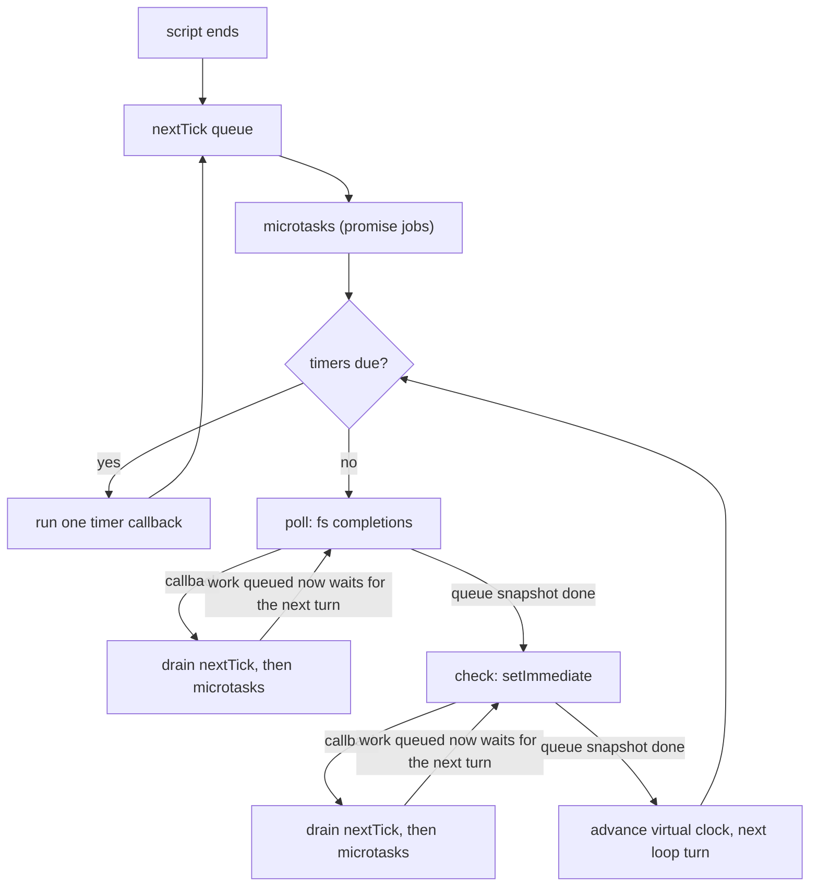

# Script Quest tiers, scheduler and engine: design

Date: 2026-11-16. Status: approved design; the plan is [2026-11-16-script-quest-tiers.md](../plans/2026-11-16-script-quest-tiers.md). Epic: #222. Also resolves #63.

**Contents:** [TLDR](#tldr) · [Goal](#goal) · [Non-goals](#non-goals) · [Current state](#current-state) · [Decisions](#decisions) · [XP continuity](#xp-continuity) · [Intermediate outline](#intermediate-outline) ([Chapter 20 and #63](#chapter-20-and-63), [Modules chapter](#modules-chapter), [Story edit](#story-edit), [Content rules](#content-rules-for-pr-6-to-9)) · [Scheduler](#scheduler) · [Engine move and content split](#engine-move-and-content-split) · [Trophy Room](#trophy-room) · [Alternatives](#alternatives) · [Risks](#risks) · [Test plan](#test-plan) · [PR chain](#pr-chain) · [Touchpoints](#touchpoints)

## TLDR

- Script Quest adopts the shared tier model without changing any old save. Its 12 chapters keep badges worth 0 XP, and the new Intermediate tier pays the normal 25 XP per badge.
- The realm, the virtual Node environment and the TypeScript checker move out of `app.js` into `shared/`, together with a new virtual scheduler.
- The scheduler gives Node's event-loop order: `nextTick`, microtasks, timers, file reads finishing in the poll phase, and sync file reads that cost virtual time. A browser spike and tests against real `node` back it.
- Eleven chapters (13 to 23) are appended after Node.js. Chapter 20 covers all three outcomes of #63.
- This spec covers PRs 3 to 9 of an 18-PR stack on `feat/222-ts-quest`. The TypeScript Quest spec is PR 10 and is not copied here.

XP model options for the Script save:

| Option | What it needs | What it gives | Main limit |
|---|---|---|---|
| **Per-tier `badgeXp` (chosen)** | Two additive options on `Tiers.create` and `renderRail` | Old saves identical, new tiers pay 25 per badge like Shell | One amendment to `docs/tiers-guideline.md:7` |
| `badgeXp: 0` for the whole quest | One option | Old saves identical | New Intermediate badges give nothing, a lasting inconsistency |
| Keep Script's own `RANKS`, use part of the helpers | Nothing shared | Smallest change | Contradicts `docs/tiers-guideline.md` section 9 step 5, and tier-end rank numbers would be hand-typed and wrong |
| Migrate to `i.j` keys and add badge XP | Key rewrite and migration | Same model as Shell | Raises XP by up to 300, breaks "same XP, rank and progress", changes the save and the Trophy Room separator |
| Pay badge XP only on chapters finished later | A per-chapter cutoff | Old saves identical | The same progress pays differently for old and new learners |

## Goal

Make Script Quest a tiered quest with an Intermediate path of 11 chapters, and give it an honest model of Node's event loop, so that #63 is met. Do it without changing any learner's XP, rank, progress or saved files, and leave the engine in `shared/` where the TypeScript Quest can load it too.

## Non-goals

- The TypeScript Quest spec, chapter list and story. PR 10 holds them. This spec only points at it.
- Rewriting chapter 12's own story, or any existing mission, key or fixture.
- Real ESM execution in the engine.
- A new "predict the order and choose" card kind.
- The nicer "x/y done" Suggested-first link, which is a TypeScript-side follow-up.
- `how` steps on the 93 existing missions (#22).
- Any change to `docs/tiers-guideline.md`, README or `AGENTS.md` in this PR. PR 5 makes them.
- Any build step or dependency. The repo stays static.

## Current state

- Script Quest is one 12-chapter, 93-mission quest in a single `programming/script-quest/app.js`, plus `index.html`, `story.js` and `style.css`. The catalog lists its missions per chapter (`shared/catalog.js:9`).
- Its save key is `script-quest-v1`. The state is `{xp, done, chap, cur, best, files, pkgs}` (`programming/script-quest/app.js:857`) with `-` between chapter and mission in the `done` keys.
- XP is `10 × missions done`, with no badge XP, and ranks come from a local table that tops out at Wizard at 700 (`programming/script-quest/app.js:799`). The old beginner total is 930.
- A chapter counts as earned when all its missions are done (`programming/script-quest/app.js:1090-1091`). Nothing stores badges.
- The rail is drawn by `app.js` itself, with `data-c`, the chapter number and group sub-headers. `tests/smoke.mjs:1689` clicks it by `data-c`.
- The JS realm, the virtual Node environment (`fs`, `path`, `process`) and the TypeScript checker live inline in `app.js`. A learner's `fs.readFile` finishes on a real 5 ms timer (`programming/script-quest/app.js:318-319`).
- `INITIAL_FILES` is read from `window.PROGRESS.defaults.files` (`programming/script-quest/app.js:856`) so the shared progress code can tell an untouched project from an edited one.
- Three test helpers slice content out of `app.js` by marker text: `tests/script/teach.test.mjs:9-11`, `tests/trophy/chapters.mjs:26-27` and `tests/content-loader.mjs:20-21`.
- `tests/smoke.mjs:4229-4232` rewrites the end of `app.js` to expose `CH`, `S`, `setChapter`, `goMission`, `runShell`, `submit`, `cmd`, `mk`, `INITIAL_FILES`, `openFile`, `saveFile`, `ed` and `MODE`, and also `RUN` through `clearRun`.
- The shared tier model (`shared/tiers.js`) is used by Shell Quest and Agent Quest. `renderRail` builds its own done keys with a fixed `.` (`shared/tiers.js:72`).
- The repo rule is that plans and specs for larger work merge before the code (`AGENTS.md:96`). The `pristine` rule for saved fields is at `AGENTS.md:79`.

## Decisions

The ids D1, D6, D7, D8, D10 and D13 are defined in the table below. The other numbers in that series belong to the TypeScript half or to the plan, so they do not appear here.

| Id | Decision | Alternatives and why they lost |
|---|---|---|
| D1 | **Extract the engine to `shared/`** (PR 4): `jsrealm.js`, `nodeenv.js`, `tscheck.js`, plus the DOM-free scheduler from PR 7. One implementation, one test home (`tests/script/`, already in the `test:engine` glob), and the golden proves nothing changed. A `shared/` change runs every quest's tests, which is right for shared code. The terminal interpreter moves later (PR 16, with `app.js` rebinding `runShell`), so until then it and the project panel stay in `app.js`. If the project panel UI does not separate cleanly, TypeScript Quest carries a thin copy of it. | Engine in `script-quest/engine/`: a TypeScript Quest regression would hide behind a Script-only CI scope. Copy: about 350 engine lines plus the scheduler, events, `http` and `fs` exist twice and drift. |
| D6 | **One Intermediate tier** with rail group labels "JavaScript in depth" and "Node in depth". `renderRail` gets additive options, so Script keeps `data-c`, the chapter numbers and its sub-headers. | Two tiers: the ticket says "Intermediate Node". Changing the tests instead loses the sub-headers. |
| D7 | **Golden and content split first** (PR 3), the golden before the move, as `docs/tiers-guideline.md:314-315` says. | Defer: Intermediate and Node content would collide in `app.js` and `shared/catalog.js`. |
| D8 | **Scheduler:** the learner's timers and `nextTick` are shadowed. A virtual loop runs one macrotask per real hop, so native promise jobs drain between steps. `nextTick` drains right after the script and after each callback. `fs` completions go in the poll phase, and sync `fs` calls charge virtual time. A virtual `Date.now` that advances per call ends busy-waits, and a loop guard (acorn inserts an iteration count) stops runaway loops. See [Scheduler](#scheduler). | Wrap native timers with `queueMicrotask` for `nextTick`: fails the #63 ordering. Replace `Promise` and transform `async`: cannot intercept native `await`. A real clock: slow tests, non-deterministic order. |
| D10 | **Folder keys with `/` in the existing flat file map** (additive). `curl` is a terminal command over a server table. `node server.js` stays running, with a Stop button. | A separate tree: bigger change. No `curl`, only in-script `http.get`: the "freeze a server" mission loses its visible hit. |
| D13 | **Chapter 20 covers all #63 outcomes**: file reads in the poll phase and charged sync reads in PR 7, a heartbeat stand-in for the server. | Move the server and `fs` outcomes to chapters 21 and 23: leaves #63's outcomes spread over two PRs. |

Four more decisions were put to the user and approved with the default. They are recorded here with their consequences:

| Decision | What it means |
|---|---|
| Per-tier `badgeXp` for old saves | The XP model in [XP continuity](#xp-continuity). |
| The lantern becomes a mid-way prize | `story.js` changes only, see [Story edit](#story-edit). |
| The Trophy Room effects are accepted | See [Trophy Room](#trophy-room). |
| CommonJS in depth, ESM as reading only | See [Modules chapter](#modules-chapter). |

The user also approved the 18-PR plan and its final close of #222 and #63 (see the plan).

## XP continuity

**Facts.** An old save has `xp = 10 × missions done`, no badges and `-` keys. The shared model adds 25 XP per chapter badge. A plain swap would raise every old rank and the old beginner total from 930 to 1230.

**Design.** `Tiers.create` and `Tiers.renderRail` get additive options:

- `badgeXp` is set per tier and defaults to 25. Script's `beginner` tier sets it to 0.
- `doneSep` defaults to `.`. Script sets `-`. It is added to both functions, because `renderRail` builds its own done keys (`shared/tiers.js:72`). No key rewriting is needed.
- `renderRail` also gets options for `data-c`, the chapter number instead of ★ when a chapter is earned, and the group sub-headers. The rail markup stays identical and the golden proves it. `tests/smoke.mjs:1689` keeps working.

Result:

- Old saves are identical, with no migration and no recompute. The stored `xp` is trusted.
- New tiers pay the normal 25 XP per badge, so Script's new content matches Shell and TypeScript Quest.
- The rule "a badge is always +25 XP" in `docs/tiers-guideline.md:7` gets one amendment, made in PR 5.

**No new stored field.** `Tiers.status` and `renderRail` read `S.badges` and `S.ch`, which Script does not store. Script already treats a chapter as earned when all its missions are done (`programming/script-quest/app.js:1090-1091`). So PR 5 builds a view at render time: badges derived from `done`, and `ch` taken from `S.chap`. The save keeps `{xp, done, chap, cur, best, files, pkgs}`. `fresh()` and the `pristine` rule (`AGENTS.md:79`) stay untouched. For the new tiers' 25 XP, the badge is paid once, when a chapter's last mission completes.

**Ranks.**

- The ladder up to 700 is unchanged, and Wizard stays at 700 as the top beginner rank. There is no new rank at 930, so nobody's old rank changes.
- Intermediate ends with a new rank, "Sorcerer", at the XP derived after the chapters are written.
- Intermediate pays 15 XP per mission. The estimate is about 2200 XP at the end of Intermediate (about 68 missions and 11 badges). This is an estimate, fixed once the chapters exist.

## Intermediate outline

One **Intermediate** tier, with rail group labels "JavaScript in depth" and "Node in depth". Chapters 13 to 23 are appended after Node.js (rail number 12), in this order so every term is taught before use. Each chapter has about 6 missions, all with `how` steps.

| # | Chapter | What goes deeper than Beginner |
|---|---|---|
| 13 | Scope and closures | Counters and private state, loops and closures |
| 14 | Destructuring and spread | Nested, defaults, rest, copying |
| 15 | Classes | `extends`, getters, static, `#private` |
| 16 | Errors and `try`/`catch` | Custom errors, `finally`, rethrow, async errors |
| 17 | Modules | CommonJS in depth, ESM syntax as reading only |
| 18 | Map and Set | Keys, iteration, when to use which |
| 19 | JSON | `stringify` options, bad JSON, dates |
| 20 | The event loop (#63) | All three #63 outcomes, see below |
| 21 | Async `fs` and `path` | Callback and promise forms, folders |
| 22 | Events | `EventEmitter`, `once`, the `error` event |
| 23 | A small HTTP server | `createServer`, `curl`, why sync work freezes it |

### Chapter 20 and #63

Chapter 20 needs only PRs 6, 7 and 8, because PR 7 puts file completions in the poll phase and charges virtual time to sync file reads.

- **Predict the order** of sync code, timers, `setImmediate`, promises and `process.nextTick`: puzzle missions of the kind "write the program that prints this order". A new predict-and-choose card kind would be new UI, so it lost.
- **`setImmediate` versus `setTimeout(0)` inside an I/O callback:** deterministic in real Node, and it works with `fs.readFile` through the poll phase. The main-module version is non-deterministic in real Node, so no mission depends on it.
- **A sync read freezes a server, and the async fix:** a heartbeat `setInterval` ("the ticket line") stands in for the server. PR 7 charges a sync `readFileSync` virtual time (for example by file size), so the heartbeat visibly stalls. The async `fs.readFile` does the same work in the poll phase and the heartbeat keeps ticking. A busy-wait on the virtual `Date.now` also stalls it. Chapter 23 repeats it on a virtual server with `curl`. The Done-when of #63 asks for the chapter and the env ordering with tests, so closing #63 does not depend on PR 9, though the final PR closes it anyway.
- **Name the phases:** the Field guide picture gains a microtask lane and the three Node phases.

### Modules chapter

Chapter 17 teaches CommonJS (`require`, `module.exports`) in depth, and shows ESM syntax (`import`, `export`) as reading only. Real ESM execution is not added to the engine.

### Story edit

- The lantern stays a mid-way prize, so the change is in `story.js` only. Chapter 12's own story is not rewritten.
- A new final Script treasure ends the Node chapters, with the circus ready to tour. It closes the arc that PR 9 finishes.
- Its name and wording are not set here. PR 6 sets them, using the `quest-story` skill and `docs/story-guideline.md`.

### Content rules for PR 6 to 9

- Every chapter has solvability tests, teach-before-use tests and own-input tests (an unrelated input completes no mission).
- Every new term gets a `FIRST` entry. The guide and quick-fire get a tier filter, so Beginner learners are not shown Intermediate material first.
- Catalog and landing-card counts grow with every content PR.
- Every content PR is checked at phone width.

## Scheduler

The scheduler is a DOM-free file in `shared/`, built in PR 7 after a browser spike. The ordering below is reasoning, not measured, until that spike runs. If the spike fails, the work stops and a new design goes to the user before anything else is built.



How it works:

- The learner's `setTimeout`, `setInterval`, `setImmediate` and `process.nextTick` are shadowed by the scheduler. The real promise machinery is left alone.
- The virtual loop runs one macrotask per real hop, so native promise jobs drain between steps. `nextTick` drains after the script and after each callback, before microtasks. A phase works on the queue as it was when the phase started, so the file completions queued before poll run in poll and the immediates queued before check run in check, with that drain between callbacks. An immediate or file completion queued during a phase runs on the next loop turn. Each loop turn starts by advancing the clock 1 ms, so in the main module a `setTimeout(0)` runs before a `setImmediate` (a model choice; real Node races them). The timers phase reads the clock once, at its start, and runs only the timers due by then. Timers are checked again only on the next loop turn, after the check phase. A stalled `setInterval` runs once, not once per missed beat.
- `fs.readFile` (callback) and `fs.promises` completions go in the poll phase. They replace the real 5 ms timer the Node environment used before.
- Sync `fs` calls charge virtual time (`Scheduler.COST`: 250 ms plus 1 ms per 4 bytes for read, write and append; 1 ms for `readdirSync`, `unlinkSync` and `existsSync`), so a stall is visible to a heartbeat timer. Async reads cost the same but do not advance the clock.
- A virtual `Date.now` advances 1 ms per call, so a busy-wait ends. An acorn-inserted counter in every loop body is the loop guard: it stops a loop after 5,000,000 iterations in one go (`ERR_LOOP_GUARD`). A run also stops after 60,000 ms of virtual time or 5,000 callbacks.
- Timers fire without waiting in real time. All of this applies to the Node environment only; the JS REPL is unchanged and has no loop guard.
- The rest of async `fs` (`readdir`, `appendFile`, `unlink`, `stat`), `EventEmitter`, `process`, `http`, `curl` and a running-process model arrive in PR 9.

## Engine move and content split

PR 3 and PR 4 change structure, not behavior. The golden proves it.

- **PR 3.** The first commit captures the golden save and a transcript of every mission from the unmodified build. The fixtures go in `tests/fixtures/` (`AGENTS.md:42`). The golden's test location and runner are chosen in PR 3, following the Shell golden. Then the curriculum, guide and quick-fire move to `programming/script-quest/content/`, and the three slicers are updated (`tests/script/teach.test.mjs:9-11`, `tests/trophy/chapters.mjs:26-27`, `tests/content-loader.mjs:20-22`). `INITIAL_FILES` stays in `app.js` (`programming/script-quest/app.js:856`).
- **PR 4.** `shared/jsrealm.js`, `nodeenv.js` and `tscheck.js` move out of `app.js`. Tests stay under `tests/script/`. The terminal interpreter and project panel stay in `app.js` until PR 16.

Target layout after PR 9 (new or moved files only):

```
shared/
  jsrealm.js        DOM-free JS realm (moved from app.js)
  nodeenv.js        virtual fs, path, process, http (moved, then grown)
  tscheck.js        TypeScript checker (moved from app.js)
  scheduler.js      virtual event loop (PR 7)
programming/script-quest/
  app.js            UI, terminal interpreter, project panel
  content/          curriculum, guide, quick-fire (moved in PR 3)
tests/script/       scheduler and chapter tests
tests/fixtures/     golden save and transcript (PR 3)
```

**Smoke hook rule.** `tests/smoke.mjs:4229-4232` keeps working only while the names it exposes stay declared in `app.js` and the file still ends with its closing `})();`. So:

- PR 3 loads the content files before `app.js` and binds `CH` once at the top of `app.js` from the content namespace.
- `CH`, `S`, `setChapter`, `goMission`, `runShell`, `submit`, `cmd`, `mk`, `INITIAL_FILES`, `openFile`, `saveFile`, `ed`, `MODE` and `RUN` stay declared in `app.js`.
- PR 4 moves only DOM-free engine code, and `app.js` rebinds any moved name it still uses.
- The smoke test is not edited. It passing unchanged in CI is an acceptance check for both PRs. It needs the jsDelivr CDN, so only CI can prove it.

## Trophy Room

The user accepted these effects of changing the catalog. The lines cited are in `shared/trophies.js`.

- **When PR 6 appends chapters,** anyone who had finished all 93 missions no longer has Script counted as complete.
  - They lose "Finisher" (`:72`) if Script was their only finished quest.
  - They lose "Playground Master: Programming" (`:75`) and "Grand Master" (`:80`) if they had finished every programming quest.
  - They get them back by finishing the new chapters.
- **When PR 11 adds TypeScript Quest to the catalog,** everyone loses "Wanderer" (`:69`, start every playground) until they start TypeScript Quest. "Playground Master: Programming" and "Grand Master" then also need TypeScript Quest finished.

## Alternatives

Alternatives to each decision are in the [Decisions](#decisions) table. The XP options are in the [TLDR](#tldr). Two choices for the whole epic were also weighed:

| Option for the whole epic | Needs | Gives | Main limit |
|---|---|---|---|
| **18 PRs, shared engine, per-tier badge XP (chosen)** | One small change to `shared/tiers.js`, 3 new `shared/` engine files plus the scheduler, one CI PR, two spec PRs | Old saves untouched, one engine for both quests, each PR reviewable | 18 merges waiting on the user |
| 11 PRs, one per Done-when item | Nothing extra | Fewest merges | Several PRs above 1000 lines, no spec before code (the repo requires one), and the golden fixture and the CI change have no home |
| Copy the engine into TypeScript Quest | No `shared/` change | Fast start | The scheduler, events, `http` and `fs` code exist twice and drift |

The two spec PRs are there because the Script half is larger work with its own decisions, so its spec and plan merge before its code. The TypeScript spec sits at PR 10, after the Script work, so it uses the real scheduler and typings.

## Risks

1. The microtask and `nextTick` ordering is reasoning, not measured. PR 7 starts with a spike and stops if it is wrong, which could force a redesign of PRs 7 to 9.
2. The smoke hook works only while the listed names stay in `app.js`. It was read but not run. It needs the jsDelivr CDN, so only CI proves it.
3. The project panel UI may not separate from `app.js` cleanly. TypeScript Quest would then carry a thin copy.
4. Mission counts, the XP estimates (about 68 missions, about 2200 XP, the Sorcerer threshold) and the 18-PR count are estimates.
5. The Trophy Room effects above are accepted, and some learners will see trophies disappear and return.
6. Every content PR must be checked at phone width.
7. The squash merge of the whole feature branch (PR 18) becomes one commit on `main`, so per-part history lives only in the PRs.
8. `main` drifts while Script improvements sit on the feature branch. Each sync is an approved push, and heavy overlap lands as conflicts on one merge.
9. Stack order assumes each PR merges before the next opens, so a long gap delays the whole chain.
10. New `files` keys may contain `/` (folder keys, PR 9). An old cached page can read them, and only a write to a name with `/` fails, so the risk is small. Script's save keeps its shape and has no new stored field, so there is no migration, and rollback is a revert of PR 5.

## Test plan

Tests per PR (all are CI signals only, as there is no backend):

- **Golden fixture and test (PR 3).** A saved game and a transcript of every mission, replayed against the build. It proves the split and the engine move change nothing. Fixtures are never regenerated.
- **Shell tier tests (PR 5).** They prove the new `Tiers.create` and `renderRail` defaults leave Shell Quest and Agent Quest identical. A Script test imports the old save fixture and checks XP and rank stay the same.
- **`vm` scheduler tests (PR 7).** Ordering tests run in a `vm` context, with a differential test that runs the same programs under real `node` and compares output. The golden transcript guards the existing Node.js chapter.
- **Chapter tests (PRs 6, 8, 9).** Solvability for every mission, teach-before-use for every term, and own-input checks.
- **The smoke test, unedited.** It runs against the bundled page in CI.

Performance (also CI signals only, as there is no backend):

- Script Quest page load is at most 10% slower than before PR 4. Compare script bytes and time to first render before and after.
- The longest scheduler ordering test finishes well under a second. The loop guard's overhead and the virtual-time charge for sync `fs` are measured in PR 7.

Observability: there is no backend, so no dashboard, alert or BI insight. The signals are the CI results above.

## PR chain

All PRs target `feat/222-ts-quest`. Sizes are changed lines: S under 150, M up to 500, L up to 1000, XL above. This spec covers PRs 3 to 9. The plan holds all 18, the stacking rules and the main-sync mechanism.

| PR | Title | Contains | Needs | Size |
|---|---|---|---|---|
| 1 | `docs(script): add the Script Quest tiers, scheduler and engine spec and plan` | This spec and the plan | none | M |
| 2 | `ci: accept the typescript scope and check the new quest folders` | Commit scope and syntax-loop globs for the new folders | none | S |
| 3 | `refactor(script): add golden fixtures and split app.js into content files` | Golden first, then content files, then the three slicers. The smoke hook keeps working. | 1, 2 | L |
| 4 | `refactor(engine): move the JS realm, Node env and TS checker to shared modules` | `shared/jsrealm.js`, `nodeenv.js`, `tscheck.js`. The golden proves nothing changed. | 3 | L |
| 5 | `feat(script): adopt the shared tier model` | `Tiers.create` and `renderRail` options, an adapter view, `beginner` tags on 12 chapters, the rank table through `rankFor`, the fixture test, README and `AGENTS.md`, and the one amendment to `docs/tiers-guideline.md:7` | 4 | M |
| 6 | `feat(script): Intermediate JavaScript tier` | Chapters 13 to 19, the tier filter for guide and quick-fire, a `FIRST` entry for every new term, catalog and landing-card counts, and the `story.js` edit | 5 | XL |
| 7 | `feat(engine): virtual Node scheduler with nextTick, microtasks, timers and poll-phase fs` | Browser spike first, then the scheduler, poll-phase `fs`, charged sync `fs`, the `vm` and differential tests | 4 | L |
| 8 | `feat(script): event loop chapter` | Chapter 20 with `how` steps, and the Field guide picture with the microtask lane and Node phases | 6, 7 | M |
| 9 | `feat(script): async fs, path, events and HTTP server chapters` | Engine: folder keys, `path`, the rest of async `fs`, `EventEmitter`, `process`, `http`, `curl` and a running-process model. Then chapters 21 to 23, ending the Script treasure arc. | 7, 8 | XL |

PRs 10 to 18 are the TypeScript half. PR 10 adds the TypeScript Quest spec and plan, and re-plans PRs 11 to 18 once PR 9 has merged.

## Touchpoints

| Touchpoint | PR | Status |
|---|---|---|
| `docs/superpowers/specs/2026-11-16-script-quest-tiers-design.md`, `docs/superpowers/plans/2026-11-16-script-quest-tiers.md` | 1 | new |
| Golden save and transcript fixtures under `tests/fixtures/`, and the golden test (location chosen in PR 3) | 3 | new |
| `programming/script-quest/content/`, `programming/script-quest/app.js`, `programming/script-quest/index.html` | 3 | moved and updated |
| `tests/script/teach.test.mjs`, `tests/trophy/chapters.mjs`, `tests/content-loader.mjs` | 3 | updated (slicers) |
| `shared/jsrealm.js`, `shared/nodeenv.js`, `shared/tscheck.js` | 4 | new (moved) |
| `programming/script-quest/app.js`, `programming/script-quest/index.html` | 4 | updated (load and rebind) |
| `shared/tiers.js` and the Shell tier tests | 5 | updated (additive options) |
| `programming/script-quest/app.js`, and a new Script tier test with the old-save fixture | 5 | updated, new |
| `docs/tiers-guideline.md:7`, `README.md`, `AGENTS.md` | 5 | updated |
| `programming/script-quest/story.js`, `shared/catalog.js`, landing card, guide and quick-fire | 6 | updated |
| The scheduler file in `shared/` and its tests under `tests/script/` | 7 | new |
| `programming/script-quest/content/` chapter files, Field guide picture | 8, 9 | new |
| `shared/catalog.js`, landing card | 8, 9 | updated (counts) |
| `shared/nodeenv.js` (folder keys, `path`, `fs`, `events`, `http`), terminal `curl`, Stop button | 9 | updated |
| `programming/script-quest/story.js` | 9 | updated (final treasure arc ends) |
| `shared/trophies.js` | none | unchanged; effects come from the catalog |
