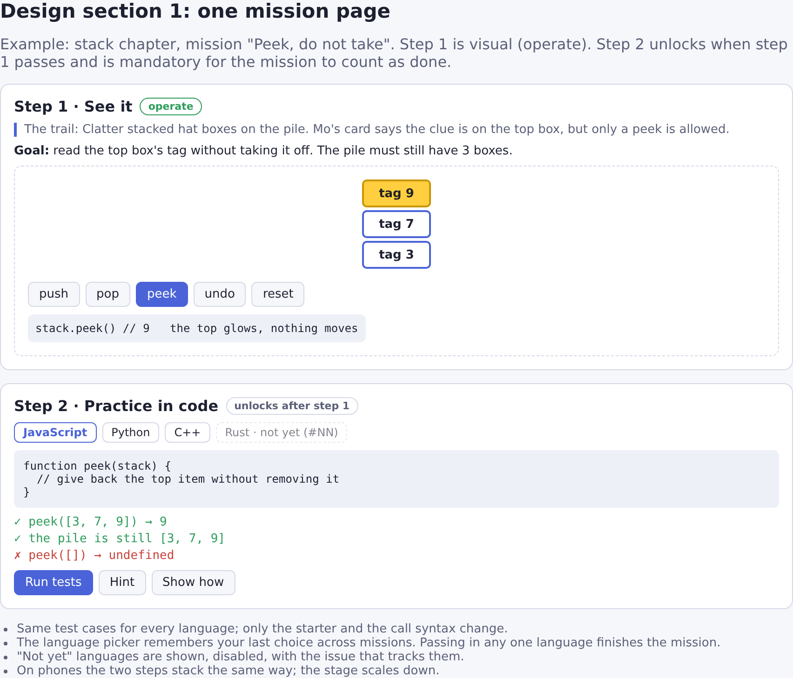

# Data Structures Quest: visual missions with practice in code

Date: 2026-11-22. Status: approved design, nothing built yet. Follow-up: #263 (replay JavaScript practice code on the picture).

## Contents

- [TLDR](#tldr)
- [Goal](#goal)
- [Decisions](#decisions)
- [Scope](#scope)
- [The mission page](#the-mission-page)
- [Missions: operate or predict](#missions-operate-or-predict)
- [Practice in code](#practice-in-code)
  - [Test cases](#test-cases)
  - [Language runners](#language-runners)
  - [Gaps and new playgrounds](#gaps-and-new-playgrounds)
- [Layout](#layout)
- [Saved progress](#saved-progress)
- [Errors](#errors)
- [Tests](#tests)
- [Delivery](#delivery)
- [Touchpoints](#touchpoints)
- [Risks](#risks)

## TLDR

Every Data Structures Quest mission becomes two steps. Step 1 is visual: the learner either operates an animated structure until it reaches a goal, or steps through an animated algorithm and predicts what happens next. Step 2, "Practice in code", is mandatory: the learner writes the same idea as a function in any language the playgrounds can run (today JavaScript, Python, C++ and Rust; TypeScript once its quest lands), checked against one set of language-neutral test cases.

The same 6 chapters and 26 missions stay, with the same ids, so saved progress keeps working. A test makes every new language playground either support the practice step or have an open issue for it.

| Option | What it needs | What it gives | Main limits |
|---|---|---|---|
| **A. DOM-free scene model plus one renderer per structure shape (chosen)** | `scenes.js`, `visual.js`, `draw.js`; grows from today's `demos.js` | Each structure keeps its own look (row, pile, line, chain, buckets, tree); every check is testable in Node | Six renderers to write |
| B. One generic graph renderer | One SVG node-and-edge layout | Less code | Arrays, stacks and queues lose their shape |
| C. Animate the learner's own code | Instrumented JS engine | Direct feedback on your own code | JavaScript only; conflicts with language-neutral practice. Kept as follow-up #263 |

## Goal

Make the Data Structures Quest mainly visual: learners see structures and algorithms move, with visual effects, and build their mental model there first. Every mission then ends with mandatory code practice in the learner's choice of language, so seeing is always followed by doing.

## Decisions

- **Two steps per mission.** Step 1 "See it" (visual) unlocks step 2 "Practice in code". A mission is done when step 1 passed and step 2 passed in any one language.
- **Two kinds of visual step, picked per mission.** Structure missions are *operate* (click operations until the structure reaches a goal). Algorithm missions are *predict* (play or step through the algorithm; at pause points answer what happens next).
- **One language-neutral test set per mission.** A mission defines a function (or class) name and its test cases. Each language adds only a starter, a reference answer and, once per language, a runner adapter.
- **A gap does not block a mission.** If a language's interpreter cannot run a mission yet, that language is listed as "not yet" with an open issue, and the other languages still count. A test fails on a gap with no issue.
- **New language playgrounds are caught by a test.** `shared/catalog.js` records which playgrounds teach a general-purpose language. A language playground with neither a runner nor a listed gap with an issue fails the test.
- **Same chapters and missions.** The 6 chapters and 26 missions keep their order and ids. New chapters (sorting, heaps, graphs) are separate future work.
- **No new runtime dependency.** Rendering is DOM and CSS (transitions and position animations), per hard rule 1.
- **Page layout.** In step 1 the animation sits on top, centered. The operations, log, controls and text sit below it, aligned left. The same holds at phone width.

## Scope

In scope: the visual step for all 26 missions, the practice step with JavaScript, Python, C++ and Rust runners, moving the Python and C++ interpreters into their own files, the catalog `lang` field and its test, the field guide switched to the new renderers, tests and docs.

Out of scope: new chapters, TypeScript (it gets its runner, or a listed gap, when its quest lands, which the catalog test enforces), replaying the learner's code on the picture (#263), and any change to how other quests look or behave.

## The mission page



*Mockup, not the final look. Notice the order: the animated structure centered on top, then operations and the operation log below. The empty-pile test in the mockup shows `undefined`; real tests use the mission's agreed "nothing" value instead (see [Test cases](#test-cases)).*

- **Step 1, "See it".** The trail strip, the goal in one sentence, then the stage: the animated structure on top, centered. Below it, aligned left:
  - Operate missions: the operation buttons, undo, reset, and an operation log (`stack.peek() // 9`).
  - Predict missions: play, step back, step and speed controls, and the pause question with its answer buttons.
  - Each step carries one plain sentence of what happened.
- **Step 2, "Practice in code".** Locked until step 1 passes. It has a language picker (it remembers the last language across missions), the starter, the test list with each case passed or failed, Run tests, Hint, and Show how (`how` steps, as every mission has today). A "not yet" language is shown disabled with its issue number.
- **Visual effects.** Items slide, drop and swap; arrows re-point; the item in focus pulses; a pass gets a short celebration on the structure itself. Everything respects `prefers-reduced-motion` (moves become instant, highlights stay).
- **Field guide.** Keeps its demos, drawn by the same renderers.

## Missions: operate or predict

The 26 missions keep their titles and order. Each one's visual kind:

| Chapter | Mission | Kind | The visual step |
|---|---|---|---|
| Arrays | Build a row | operate | Push tags until the row matches the card |
| Arrays | Pick a box | operate | Read the box the card names |
| Arrays | Add and remove | operate | Reach a target row with push, pop, shift, unshift |
| Arrays | Walk the row | predict | A loop visits each box; predict the running total |
| Arrays | Find the biggest | predict | Predict when "biggest so far" changes |
| Stacks | A pile of hat boxes | operate | Build the pile in the card's order |
| Stacks | Peek, do not take | operate | Read the top without removing it |
| Stacks | Build a Stack class | operate | Operate the stack and watch the array underneath |
| Stacks | Are the brackets balanced? | predict | Predict the pile after each bracket, and the verdict |
| Queues | Join the line | operate | Enqueue and dequeue to reach the target line |
| Queues | Build a Queue class | operate | Operate the queue and watch both ends |
| Queues | Hot potato | predict | Predict who leaves each round |
| Linked lists | Link three nodes | operate | Drag arrows to link the nodes in order |
| Linked lists | Walk the chain | predict | Predict where the pointer lands next |
| Linked lists | A LinkedList class | operate | Add and remove nodes; arrows re-point |
| Linked lists | Reverse the chain | predict | Predict each arrow flip |
| Maps | Name tags | operate | Put tags in their buckets |
| Maps | Is it in here? | operate | Ask the map; see the single bucket it checks |
| Maps | Count the words | predict | Predict each count after the next word |
| Maps | First repeat | predict | Predict the first word seen twice |
| Maps | Two numbers that add up | predict | Predict which partner the map looks for |
| Trees | Plant a tree | operate | Attach nodes as left or right children |
| Trees | How tall is it? | predict | Predict each subtree's height |
| Trees | Insert into a search tree | operate | Walk left or right to place the value |
| Trees | Read it in order | predict | Predict the next node visited |
| Trees | Find a value | predict | Predict each left or right turn |

The mission author may change a mission's kind while writing it if the other kind teaches it better. The table in this spec is the starting point, and the content is what counts.

**Operate check.** A start state, the allowed operations, and a goal predicate on the final state, with an optional "fewest moves" star. Passing depends only on the learner's operations in this mission (hard rule 5).

**Predict check.** The algorithm runs on the scene model and records its steps. Pause points name a step, a question and the correct answer, computed from the recorded steps, never typed by hand. A wrong answer shows what really happens and replays that step; the learner retries from that pause.

## Practice in code

### Test cases

Each mission's `practice` block has:

- `fn`: a function to write, with `tests` as `{args, want}` pairs; or `cls`: a class to write, with `tests` as call sequences (`[['push', 3], ['pop']]`) and the wanted return of each call.
- Values are limited to integers, booleans, strings and lists of integers or strings, so every language can express them. "Nothing" (not found, empty) is a value the mission states, such as `-1` or `""`, never `null`.
- Linked list and tree missions get helper code in the starter (a node type plus `fromList` and `toList`, or the tree equivalents), so the tests stay plain lists. The learner writes only the mission's function.
- Per language: `starter`, reference `answer`, and the `wrong` and `lazy` answers the solvability test uses.

Today's JavaScript code missions become the JavaScript practice step. Their current checks are turned into test cases where they check outcomes; any check that does not fit the test-case shape is rewritten as one.

### Language runners

`practice.js` holds a registry of runners, one per language, each with the same small interface: run this code against these test cases and return a pass or fail per case, with the language's own error text.

| Language | Interpreter | Where it lives |
|---|---|---|
| JavaScript (`js`) | Today's DS engine (real JavaScript, loop guard) | `programming/ds-quest/engine.js` |
| Python (`py`) | Mini Python | Moved from `programming/python-quest/app.js` to `programming/python-quest/engine.js` |
| C++ (`cpp`) | Mini C++ | Moved from `programming/cpp-quest/app.js` to `programming/cpp-quest/engine.js` |
| Rust (`rs`) | Rust Quest engine | `programming/rust-quest/engine/` (already separate) |

The Python and C++ interpreters are already self-contained blocks at the top of those `app.js` files that never touch the page. Moving them is a cut and paste plus a `<script>` tag. Those two quests must behave the same afterwards, and their tests and fixtures must pass unchanged. The Data Structures Quest page loads the engines by relative path, which `tools/build.py` already inlines.

### Gaps and new playgrounds

- `practice.js` has a `PENDING` list of `{mission, lang, issue}`. A listed pair shows as "not yet" in the picker.
- `shared/catalog.js` gains `lang` on every playground: `'js'` for Script Quest, `'py'`, `'cpp'`, `'rs'`, later `'ts'`, and `null` for Shell, Harbor, Network, Agent, Data Structures and Math.
- A test fails when a catalog `lang` has no runner and no `PENDING` entry with an issue, and when a mission and language pair neither passes its reference answer nor is listed in `PENDING` with an issue.

## Layout

```
programming/ds-quest/
  scenes.js     DOM-free: one model per structure (row, pile, line, chain, buckets, tree); ops return a step
                (what changed, highlights, pointers, one sentence). Grows from demos.js, which it replaces.
  visual.js     DOM-free: operate goals and predict pause points, and their checks
  practice.js   DOM-free: test-case runner, language registry, PENDING
  engine.js     JavaScript runner (as today)
  content.js    CH, QF, GUIDE; each mission gains `visual` and `practice`
  draw.js       renderers and animations for the six shapes
  app.js        page: step 1, step 2, picker, field guide
programming/python-quest/engine.js   moved Mini Python
programming/cpp-quest/engine.js      moved Mini C++
shared/catalog.js                    `lang` per playground
tests/ds/                            solvability, gaps, catalog, own action, saves
```

## Saved progress

- Key `ds-quest-v1` and mission ids `'<chapter>.<mission>'` stay. The catalog's mission counts do not change.
- New fields: `seen` (missions whose step 1 passed), `lang` (the last language picked) and `codes` (non-JavaScript code keyed `'<chapter>.<mission>.<lang>'`). JavaScript code stays in today's `code` map, so saved code keeps loading. `codes` is already in `TEXT_MAPS` in `shared/progress.js`. `seen` and `lang` go in this page's `PROGRESS` defaults.
- A mission in an old save's `done` counts as done, with both steps open.

## Errors

- Learner code that throws, loops forever, or breaks a language's rules shows that language's own message on the failing test case. Every runner keeps its engine's loop guard and step limit.
- An operation that is not allowed (popping an empty pile) shakes the structure and says why, without changing state. Undo and reset are always available.
- A wrong prediction is explained and replayed, and the learner retries from that pause.

## Tests

- **Solvability** (`tests/ds/`): each operate mission's reference sequence reaches the goal, and a wrong and a lazy sequence fail. Each predict mission's answers match its recorded steps. Every language's reference `answer` passes the tests, and its `wrong` and `lazy` answers fail.
- **Gaps:** every mission and language pair passes or is listed in `PENDING` with an issue.
- **Catalog:** every `lang` has a runner or a `PENDING` entry with an issue.
- **Own action** (`tests/ds/own-action.test.mjs`): step 1 passes only on this mission's operations or answers, and step 2 only on this mission's code.
- **Saves:** an old save with 26 done missions still shows 26 done.
- **Moved interpreters:** Python and C++ Quest tests and fixtures pass unchanged.
- **Browser:** smoke and screenshots at desktop and 390px, light and dark, plus reduced motion.

## Delivery

1. This spec, in its own PR to `main`.
2. An epic issue and a feature branch, `feat/<epic>-ds-visual`, with chained PRs into it, in this order:
   1. Move the Python and C++ interpreters into `engine.js` files.
   2. `scenes.js` and `draw.js`, with the field guide switched over.
   3. `visual.js` and the mission page.
   4. `practice.js`, the runners and the catalog `lang` field with its test.
   5. Mission content in three batches: arrays and stacks, then queues and linked lists, then maps and trees. Each batch adds the visual step, the practice step and the gaps with their issues.
   6. Docs and touchpoints.
3. A final PR from the feature branch to `main`.

## Touchpoints

- `AGENTS.md`: the "Change Data Structures Quest" and "Add a whole playground" rows (the new `lang` field and the practice step), and the `node --check` file list.
- `.claude/skills/new-playground`: add the step "set `lang` in the catalog; add a DS practice runner or open an issue and list it in `PENDING`".
- `.claude/skills/add-mission`: Data Structures missions need `visual` and `practice`.
- `docs/tiers-guideline.md`: the two-step mission shape for this quest.
- `README.md`: the repo map line for Data Structures Quest.
- `tests/tools/progress-pristine.test.mjs`: covers the new saved fields.
- `tests/ds/demos.test.mjs` moves to the scene models; `tests/ds/content.test.mjs` and `tests/ds/teach.test.mjs` cover the new `visual` and `practice` text.

## Risks

- **Interpreter coverage is unverified.** Classes in Mini Python, `new` and pointers in Mini C++, and `Box` and `Option` in the Rust engine have not been checked against the linked list and tree missions. The reference answers will show it. Gaps become `PENDING` entries with issues, by decision.
- **Page weight.** The page loads four interpreters (roughly 6,000 lines). The bundle stays far below the artifact limit, but first load is slower. If that is noticeable, load an interpreter only when its language is picked, while keeping the bundle inlined.
- **Rust and typed starters.** C++ and Rust starters must fix the types (`std::vector<int>`, `Vec<i64>`). The test value set is kept small for this reason.
